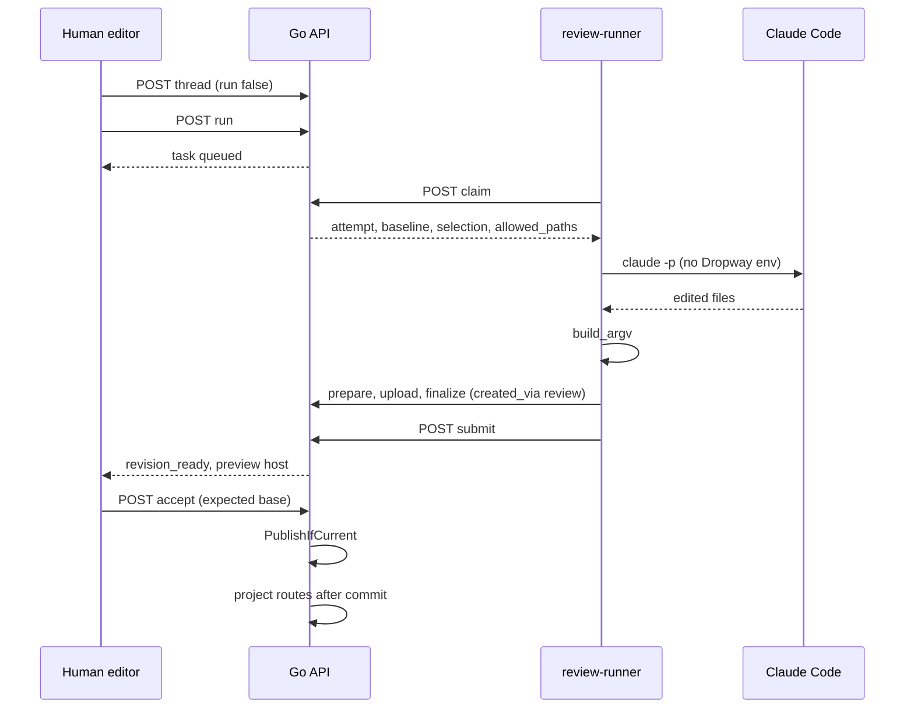
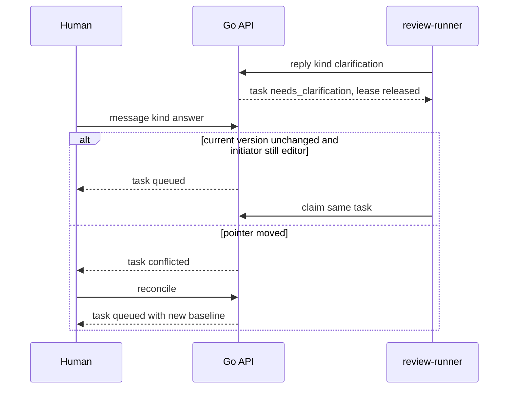
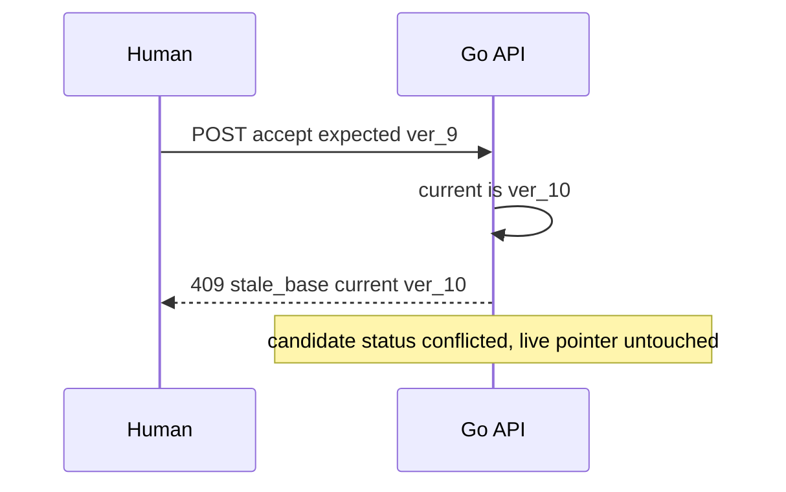
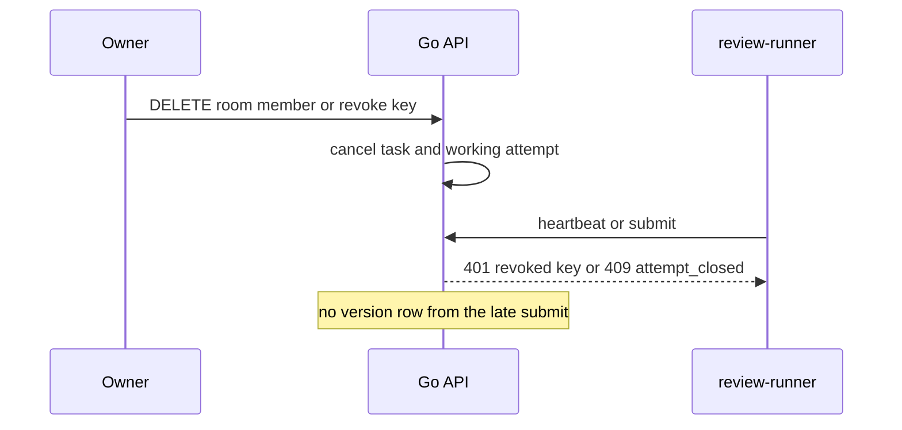

# Project collaboration implementation plan

> **For agentic workers:** REQUIRED SUB-SKILL: Use superpowers:subagent-driven-development (recommended) or superpowers:executing-plans to implement this plan task-by-task. Steps use checkbox (`- [ ]`) syntax for tracking.

**Goal:** Let same-org teammates share existing sites in a project room, anchor a comment or an explicit agent run to a selected component or text passage on a known version, and have a human accept or reject the agent's candidate without the agent publishing it.

**Architecture:** Postgres (`app` schema, goose, sqlc, FORCE RLS) remains the system of record. The Go API remains the authorization boundary. Rooms reference sites; they do not copy them. Review threads are new tables, not `app.site_comments` and not `app.chat_logs`. A candidate is a normal immutable `app.site_versions` row plus a preview host from `store.CreatePreviewRoute`; it does not flip `sites.current_version_id`. The only v1 runner is a pull loop in the existing `dropway` CLI: it leases a job with a site-scoped `reviews:run` API key and shells out to Claude Code with no Dropway credential in the child environment. The dashboard frames the existing `?embed=1` content host and talks to an opt-in page script over `postMessage`. Nothing in this feature is pushed into `projection.RouteValue`.

**Tech Stack:** Go 1.25 API (`services/api`), sqlc (`db/sqlc`), goose (`db/migrations/app`), chi router, pgx, existing presigned deploy path, Next.js 15 dashboard (`apps/dashboard`), Cloudflare serving Worker only as the already-framable embed surface, Cobra CLI, MCP Go SDK for pull tools, Vitest, `go test` (hermetic) and `go test -tags integration` (Postgres).

**Grounded against:** commit `2891c94c8f24033896b365063c83f17b3d75cd63` (`Add a Details-tab download for a site's published files (#154)`, 2026-10-08). Product requirements are the canvas "Dropway: project collaboration" (page source export). Canvas defaults are proposals. Where they disagree with this commit, this plan follows the commit and says so.

**This document is not implementation and not approval to implement.** No migration was applied, no test in this plan was run, and no runner was started while writing it.

## Global Constraints

Copied from the requirements page, plus the repo rules they have to live inside.

- V1 is same-organization collaboration and one external-runner adapter.
- Out of v1: generic chat, full task management, live co-editing, an agent hosting platform, automatic action on comment submission, external email or Slack, guest and cross-org invites.
- A room holds references to existing sites, not copies. Removing a reference does not delete the site. A site may be in multiple rooms. Revisions are shared; discussion belongs to the room.
- Room roles never grant underlying site edit or read rights. Effective access is the intersection of room membership, existing site authorization, and the action.
- Public site links stay public. Attaching a site to a room never exposes room discussion. Private sites stay private.
- Unauthorized sites are omitted from room listings, search, activity, counts, and agent context. Do not include their titles.
- Selection is promised only for supported previews. A page-level comment is a fallback and does not count as selection.
- Never inject a review script into arbitrary deployed HTML. Compatibility is checked before Run is enabled.
- No fuzzy match may move a thread onto a different passage. A human may explicitly reanchor.
- Agent replies cannot approve or resolve. Accept and confirm-resolution are human-only.
- Run is explicit. A comment does not start work. The initiator delegates only the intersection of their rights, never a superuser agent.
- Existing broad MCP credentials are not passed to the job.
- Answering a clarification resumes the same task only after a fresh permission and baseline check. A changed baseline is a conflict, not a silent rebase.
- Finite runtime, spend ceiling, cancellation, and bounded retries. No external messages, dependency installs, or unrelated side effects.
- Accepting a candidate does not resolve every thread and does not mark the version approved. A later publish leaves old approval rows intact and the new current version unreviewed.
- In-product unread only. No schedulers, email, or Slack.
- Do not log document text, quotes, or instructions by default.
- Repo: FSL header on new Go and SQL. Goose Up and Down. New tenant tables carry `org_id`, an index leading with `org_id`, ENABLE and FORCE ROW LEVEL SECURITY, and the subquery-free `org_id = NULLIF(current_setting('app.current_org_id', true), '')::uuid` policy. `identity` stays Better Auth's. Core must not import `cloud/` or `ee/`. DCO sign-off on every commit. Do not edit `db/migrations/app/0001_baseline.sql`. Next migration number is `0019`.
- `projection.RouteValue` stays schema version 4 (`internal/projection/projection.go`, `SchemaVersion = 4`). Do not add thread, room, or task fields to `contracts/kv-route.schema.json`.

---

## 1. Verified architecture

Module path is `github.com/danielpang/dropway`.

### Auth and org tenancy

- Dashboard identity is Better Auth (Google, email, magic link). Organization membership is `identity.member("organizationId","userId","role")`. The Go API only reads it.
- Roles in `services/api/internal/store/members.go`: `RoleOwner = "owner"`, `RoleAdmin = "admin"`, `RoleMember = "member"`. `IsAdminRole` is owner or admin. There is no reviewer role in the org model. Room roles are a new, room-scoped vocabulary and must not be written into `identity.member`.
- `store.Tenant` is `{OrgID, UserID}`. Every store call opens a transaction and runs `middleware.SetTenantContext`, which sets `app.current_user_id` and `app.current_org_id` with `SET LOCAL` (`internal/middleware/rlstx.go`). The runtime role is non-BYPASSRLS `dropway_app`.
- Live membership is re-checked. `API.requireAdmin` (`services/api/internal/handlers/handlers.go`) refuses API-key callers even if the key creator is an owner. `API.requireOrgMember` re-reads `identity.member`.
- Content edits use `API.requireSiteEditor` (`services/api/internal/handlers/collab.go`): if `site.AllowMemberEdits` or the caller is `site.OwnerUserID`, any live org member may edit; otherwise only an admin. Access mode, allowlist, revocation, and domains stay admin-gated. Delete stays creator-or-admin. The toggle column is `app.sites.allow_member_edits` (migration `0014_collab_toggles.sql`), default true.
- There is no per-member site ACL inside an org. RLS hides other orgs, not sibling sites. `GET /v1/sites` returns every site in the caller's org.

### Database

- Goose migrations in `db/migrations/app/`. Latest file on this commit is `0018_drop_ai_builder.sql`.
- sqlc reads `db/sqlc/schema.sql` plus `db/sqlc/query.sql` and writes `services/api/internal/store/db`. Regenerate with `go run github.com/sqlc-dev/sqlc/cmd/sqlc generate -f db/sqlc/sqlc.yaml`. UUID columns are Go strings.
- `app.sites` (`0001_baseline.sql`): `id`, `org_id`, `slug`, `owner_user_id`, `access_mode` in `public|password|allowlist|org_only`, `current_version_id`.
- `app.site_versions`: immutable rows, `version_no`, `status` in `pending|uploading|ready|failed`, `content_hash`, `r2_prefix`, `created_by`. `created_via` is constrained by `site_versions_created_via_check` to `deploy|ai` (migration `0010_ai_builder.sql`). `preview_expires_at` marks a draft preview. Unique `(site_id, content_hash)` makes a byte-identical re-deploy return the existing row (`store.CreateSiteVersion`).
- `app.site_comments` (migration `0006`, later reshaped by `0009`) are org feed comments: author, body, mentions. They have no version, no selection, no room, no status. Do not extend them into review threads.
- `app.chat_logs` / `app.chat_messages` (migration `0013`) are the "How this was made" transcript. One attached log per site. Not a review thread.
- `app.org_memories` (migration `0017`) is opt-in (`org_meta.memory_enabled` default false). Source kinds do not include review. Do not add one.
- `app.api_keys` (migration `0016`): sha256 hash, `scopes text[]` default `{sites:*}`, nullable `site_id` documented as unwired. `app.resolve_api_key(hash)` returns id, org, creator, expiry, revoked, org status, `api_keys_enabled`. It does not return scopes or `site_id`. No Go code enforces `scopes`. Keys act as `created_by` and are member-capped.
- `app.audit_log` columns include `actor_user`, `actor_token`, `action`, `target`, `metadata`, `request_id`, `trace_id`. Action strings live in `internal/audit/audit.go` and are pinned by `TestActionVocab`.

### Publishing, hosting, CSP, access

- Deploy path: `POST /v1/sites/{id}/deployments/prepare`, client PUTs presigned blobs, `POST /v1/sites/{id}/deployments` finalizes, `POST /v1/sites/{id}/publish` flips the pointer. CLI `dropway deploy` always publishes (`cli/internal/cmd/deploy.go`). MCP `deploy_site` publishes by default (`services/mcp/internal/tools/tools.go`).
- `store.Publish` does not take an expected version. It sets `current_version_id` when the version belongs to the site and the host route belongs to the org. Rollback is the same function. After commit, `API.Publish` writes every non-preview `projection.RouteValue` and deletes preview KV keys. A KV failure returns an error while Postgres is already updated; `projection.Writer.RebuildFromDB` is the repair.
- `store.CreatePreviewRoute` pins `<shortVersionID>--<org>--<slug>` to that version and does not change the live pointer. Publishing deletes preview rows.
- Content is served by `services/serve` and `edge/serving-worker`. Tenant HTML is on a separate content registrable domain. `CONTENT_CSP` in `edge/serving-worker/src/security.ts` and `services/serve/internal/servehttp/security.go` sets `frame-ancestors 'none'` and `X-Frame-Options: DENY`. `?embed=1` widens that response to `frame-ancestors *` and drops `X-Frame-Options` (`edge/serving-worker/src/index.ts`, `asFramable`). The Worker also injects a free-tier banner and, when `RouteValue.chat_id` is set, a same-origin chat pill. Those injections are not a review channel.
- Gated bytes are not served to an anonymous embed. Edge tokens come from `POST /v1/authz/mint` (`store.AuthorizeMint`) or the password exchange. Revocation is the `revoked:` KV denylist (`internal/edgerevoke`).
- Access modes are an edge concern. An org member can already read a password-mode site's files through the API. v1 must not pretend a room creates a finer ACL the schema does not have. The add-site screen computes who cannot open the published URL; it does not change `site_access_policy`.

### Versions

- `current_version_id` is the live pointer. Historical rows stay. `content_hash` is the manifest digest from `internal/manifest.Digest` (sha256 of sorted `"<sha256>  <path>\n"` lines).
- No component id, source path, or text offset is stored on a version today.

### MCP

- `services/mcp/cmd/mcp/main.go` is a Streamable HTTP server (`github.com/modelcontextprotocol/go-sdk/mcp`). The client calls tools. The server cannot open a connection to a client that is not already calling it.
- Auth is OAuth 2.1 against the dashboard, or a `dw_live_` API key when `API_URL` is set. `mcp_enabled` is re-checked per request.
- Writes are registered only when `svc.API != nil`: `create_site`, `set_site_access`, `deploy_site`, `upload_skill`, `share_chat`, `append_chat`, `search_memory`, `list_memories`, `add_memory`. Reads include `list_sites`, `list_files`, `read_file`, `download_site`, `get_site_chat`.
- The MCP process holds no object-store credentials. File bytes go through the Go API with the forwarded token.

### Dashboard

- Next.js App Router under `apps/dashboard/app/(app)/`. Site detail is `app/(app)/sites/[id]/page.tsx`. Nav links are `NAV_LINKS` in `apps/dashboard/components/main-nav.tsx`.
- Mutations that need the session JWT go through server actions (see `addCommentAction` used by `components/sites/site-comments.tsx`).
- API types are generated: `pnpm --filter @dropway/dashboard gen:api` from `services/api/openapi/openapi.yaml`.
- There is no feature-flag service. Org kill switches are booleans on `app.org_meta`. `memory_enabled` defaults false; `mcp_enabled`, `chat_logs_enabled`, and `api_keys_enabled` default true. Handlers follow `API.requireChatLogs`.

### Runtime, jobs, queues

- There is no job table, lease, outbox, or worker process. `services/api/ops` is operator GC and projection rebuild, invoked by `dropway gc` and `dropway dr`, not a request queue.
- Idempotency that exists today is content-hash identity of a deploy, allowlist claim, and revocation `max(min_iat)`. There is no `Idempotency-Key` header.
- Product analytics is PostHog (`apps/dashboard/lib/analytics-server.ts`, `internal/phclient`). Audit is Postgres.

### Tests and build

- CI (`.github/workflows/ci.yml`): `go build ./...`, `go vet ./...`, `go test ./...`, `go build -tags cloud ./...`. Docs-only diffs skip that job.
- Integration tests are `//go:build integration` and start Postgres 16 plus MinIO themselves: `go test -tags integration ./services/api/internal/integration/...`.
- Dashboard unit tests: `pnpm --filter @dropway/dashboard test` (Vitest). Typecheck: `pnpm -r typecheck`.
- Handler tests use an in-memory `fakeStore`. Store logic that is SQL-shaped belongs in the integration test, not in a claim that `go test ./...` covers it.

## 2. Decisions and limits

These are the choices an implementer should not relitigate unless the prototype falsifies them.

1. **One pull adapter, Claude Code, on a machine that already has the checkout.** Dropway does not clone repos or host agents. The universal protocol is the job HTTP API. The only adapter coded in v1 is `claude_code` behind `cli/internal/runner.Adapter`. Cursor, Codex, and any cloud-agent product API are not v1 adapters. This plan does not call, and Dropway must not call, the internal Cursor cloud-agent API.
2. **Delegated identity is the human initiator, not the key owner.** A `reviews:run` key may lease only tasks for its `site_id`. Version rows and preview writes use `Tenant{UserID: task.InitiatorUserID}` after a fresh `requireSiteEditor` check for that initiator. Using the key creator would turn an admin-minted key into a superuser whenever `allow_member_edits` is false.
3. **Selection is an explicit bridge plus a private map.** The serving Worker does not inject review JavaScript. A build (or a hand-placed script) ships `/dropway-review.js` and `data-dw-id` attributes. Source paths live in a private object, not in the public manifest. Pages without the script get a page-level comment and a disabled Run button.
4. **Publish concurrency is enforced when a review is open, and always on accept.** Adding a required expected-version field to every current caller would break `dropway deploy`, MCP `deploy_site`, and the rollback dialog in one step. Those callers keep working while the site has no open review task. If a task is `queued`, `working`, `needs_clarification`, or `revision_ready`, `POST /v1/sites/{id}/publish` without `expected_current_version_id` returns 409 `review_in_progress`. Accept always compares. After the prototype, make the field required on every publish.
5. **Same-org v1 does not invent per-member site ACLs.** Intersection uses room role plus the gates that exist (`requireOrgMember`, `requireSiteEditor`, admin gates). The add-site preview reports who fails the edge rule (`AuthorizeMint` / allowlist), and those people still see the site in the dashboard if they are org members, because the API already allows that. Hiding sibling sites from org members is a different product and is not in this plan.
6. **Lease expiry is lazy.** Nothing in the repo polls. `ExpireStaleAttempts` runs at the start of claim, heartbeat, task GET, and room overview. A dead runner is not marked timed out until one of those requests. Do not add a cron or a hosted queue to paper over that.
7. **Artifacts in v1 are sites only.** Skills and chat logs are not room artifacts.

## 3. File map

Create:

- `db/migrations/app/0019_project_rooms.sql`
- `services/api/internal/review/access.go` and `access_test.go`
- `services/api/internal/review/anchor.go` and `anchor_test.go`
- `services/api/internal/review/state.go` and `state_test.go`
- `services/api/internal/review/redact.go` and `redact_test.go`
- `services/api/internal/store/rooms.go`
- `services/api/internal/store/reviews.go`
- `services/api/internal/handlers/rooms.go` and `rooms_test.go`
- `services/api/internal/handlers/reviews.go` and `reviews_test.go`
- `services/api/internal/handlers/review_jobs.go` and `review_jobs_test.go`
- `services/api/internal/handlers/review_auth.go` and `review_auth_test.go`
- `cli/internal/runner/adapter.go`
- `cli/internal/runner/claude_code.go` and `claude_code_test.go`
- `cli/internal/runner/loop.go` and `loop_test.go`
- `cli/internal/cmd/review_runner.go` and `review_runner_test.go`
- `apps/dashboard/lib/review-bridge.ts` and `apps/dashboard/test/review-bridge.test.ts`
- `apps/dashboard/lib/review-access.ts` and `apps/dashboard/test/review-access.test.ts`
- `apps/dashboard/app/(app)/rooms/page.tsx`
- `apps/dashboard/app/(app)/rooms/new/page.tsx`
- `apps/dashboard/app/(app)/rooms/[roomId]/page.tsx`
- `apps/dashboard/app/(app)/rooms/[roomId]/artifacts/[artifactId]/page.tsx`
- `apps/dashboard/app/(app)/rooms/actions.ts`
- `apps/dashboard/components/rooms/create-room-form.tsx`
- `apps/dashboard/components/rooms/room-overview.tsx`
- `apps/dashboard/components/rooms/review-preview.tsx`
- `apps/dashboard/components/rooms/review-sidepanel.tsx`
- `apps/dashboard/components/rooms/run-agent-dialog.tsx`
- `apps/dashboard/components/rooms/candidate-compare.tsx`
- `apps/dashboard/components/rooms/source-binding-form.tsx`
- `examples/review-bridge/dropway-review.js`
- `examples/review-bridge/README.md`

Modify:

- `db/sqlc/schema.sql` and `db/sqlc/query.sql`
- `services/api/internal/router/router.go`
- `services/api/internal/store/versions.go` (`Publish` expected version, `created_via=review`)
- `services/api/internal/handlers/deployments.go` (`publishRequest`)
- `services/api/internal/handlers/sites.go` delete hook is unnecessary if the trigger is correct; still call nothing extra that can drift
- `services/api/internal/handlers/revoke.go` (cancel on member revoke)
- `services/api/internal/handlers/apikeys.go` and `services/api/internal/store/apikeys.go`
- `services/api/openapi/openapi.yaml`
- `internal/audit/audit.go` and `internal/audit/audit_test.go`
- `services/mcp/internal/tools/tools.go` and `tools_test.go`
- `cli/internal/cmd/root.go`
- `cli/internal/cmd/deploy.go` (pass expected version when a 409 body says `review_in_progress`)
- `apps/dashboard/components/main-nav.tsx`
- `apps/dashboard/lib/api.ts` (hand-written client wrappers next to generated types)
- `edge/serving-worker` is not modified. Framing already exists. Do not inject a bridge there.

## 4. Schema

Migration `0019_project_rooms.sql`. Every new table below gets the same RLS stanza as `app.site_comments` in `0006_feed_meta_and_comments.sql`: ENABLE, FORCE, the `NULLIF` policy, and `GRANT SELECT, INSERT, DELETE, UPDATE TO dropway_app`. Indexes that the queries use are created in the same file. `org_id` leads every secondary index that is not already constrained by a parent FK lookup inside one org.

Enum checks (text + `CHECK`, matching `site_access_policy_mode_check`, not Postgres enums):

- Room role: `owner`, `editor`, `reviewer`, `viewer`.
- Thread status: `open`, `resolved`.
- Selection kind: `text`, `component`, `page`.
- Locate status: `anchored`, `orphaned`, `unmapped`, `page`.
- Task status: `queued`, `working`, `needs_clarification`, `revision_ready`, `accepted`, `changes_requested`, `failed`, `cancelled`, `timed_out`, `conflicted`.
- Attempt status: `working`, `submitted`, `failed`, `cancelled`, `timed_out`, `rejected`, `clarifying`.
- Candidate status: `pending`, `accepted`, `rejected`, `conflicted`, `superseded`.
- Message author: `human`, `agent`.
- Message kind: `comment`, `instruction`, `clarification`, `answer`, `progress`, `candidate`, `system`.
- Binding edit mode: `source`, `static`.
- Activity kind: `room_created`, `member_added`, `member_removed`, `artifact_added`, `artifact_removed`, `thread_opened`, `message`, `task_state`, `candidate_ready`, `accepted`, `changes_requested`, `resolved`, `approved`, `reanchored`.

```sql
-- SPDX-License-Identifier: FSL-1.1-Apache-2.0
-- +goose Up

-- +goose StatementBegin
ALTER TABLE app.org_meta
    ADD COLUMN project_rooms_enabled boolean NOT NULL DEFAULT false;
-- +goose StatementEnd

-- +goose StatementBegin
ALTER TABLE app.site_versions DROP CONSTRAINT site_versions_created_via_check;
-- +goose StatementEnd
-- +goose StatementBegin
ALTER TABLE app.site_versions ADD CONSTRAINT site_versions_created_via_check
    CHECK (created_via IN ('deploy', 'ai', 'review'));
-- +goose StatementEnd

-- +goose StatementBegin
CREATE TABLE app.project_rooms (
    id          uuid PRIMARY KEY DEFAULT gen_random_uuid(),
    org_id      uuid NOT NULL REFERENCES app.org_meta (id) ON DELETE CASCADE,
    slug        text NOT NULL,
    name        text NOT NULL,
    created_by  uuid NOT NULL,
    archived_at timestamptz,
    created_at  timestamptz NOT NULL DEFAULT now(),
    UNIQUE (org_id, slug)
);
-- +goose StatementEnd

-- +goose StatementBegin
CREATE TABLE app.project_room_members (
    org_id      uuid NOT NULL REFERENCES app.org_meta (id) ON DELETE CASCADE,
    room_id     uuid NOT NULL REFERENCES app.project_rooms (id) ON DELETE CASCADE,
    user_id     uuid NOT NULL,
    role        text NOT NULL CHECK (role IN ('owner', 'editor', 'reviewer', 'viewer')),
    created_at  timestamptz NOT NULL DEFAULT now(),
    PRIMARY KEY (room_id, user_id)
);
-- +goose StatementEnd

-- +goose StatementBegin
CREATE TABLE app.project_room_artifacts (
    id            uuid PRIMARY KEY DEFAULT gen_random_uuid(),
    org_id        uuid NOT NULL REFERENCES app.org_meta (id) ON DELETE CASCADE,
    room_id       uuid NOT NULL REFERENCES app.project_rooms (id) ON DELETE CASCADE,
    site_id       uuid REFERENCES app.sites (id) ON DELETE SET NULL,
    slug_snapshot text NOT NULL,
    removed_at    timestamptz,
    tombstoned_at timestamptz,
    created_by    uuid NOT NULL,
    created_at    timestamptz NOT NULL DEFAULT now()
);
-- +goose StatementEnd

-- +goose StatementBegin
CREATE UNIQUE INDEX project_room_artifacts_live_site
    ON app.project_room_artifacts (room_id, site_id)
    WHERE site_id IS NOT NULL AND removed_at IS NULL;
-- +goose StatementEnd

-- +goose StatementBegin
CREATE TABLE app.review_threads (
    id                  uuid PRIMARY KEY DEFAULT gen_random_uuid(),
    org_id              uuid NOT NULL REFERENCES app.org_meta (id) ON DELETE CASCADE,
    room_id             uuid NOT NULL REFERENCES app.project_rooms (id) ON DELETE CASCADE,
    artifact_id         uuid NOT NULL REFERENCES app.project_room_artifacts (id) ON DELETE CASCADE,
    site_id             uuid,
    status              text NOT NULL DEFAULT 'open' CHECK (status IN ('open', 'resolved')),
    selection_kind      text NOT NULL CHECK (selection_kind IN ('text', 'component', 'page')),
    version_id          uuid NOT NULL,
    content_hash        text NOT NULL,
    page_path           text NOT NULL,
    quote               text NOT NULL DEFAULT '',
    prefix              text NOT NULL DEFAULT '',
    suffix              text NOT NULL DEFAULT '',
    start_offset        integer,
    end_offset          integer,
    component_id        text NOT NULL DEFAULT '',
    fingerprint         text NOT NULL,
    locate_status       text NOT NULL CHECK (locate_status IN ('anchored', 'orphaned', 'unmapped', 'page')),
    resolved_by         uuid,
    resolved_at         timestamptz,
    created_by          uuid NOT NULL,
    created_at          timestamptz NOT NULL DEFAULT now(),
    CHECK (char_length(quote) <= 500),
    CHECK (char_length(prefix) <= 80),
    CHECK (char_length(suffix) <= 80),
    CHECK (char_length(page_path) <= 1024),
    CHECK (char_length(component_id) <= 200),
    CHECK (page_path !~ '\.\.'),
    CHECK (
        (selection_kind = 'page' AND locate_status = 'page' AND quote = '' AND component_id = '')
        OR (selection_kind = 'text' AND quote <> '' AND start_offset IS NOT NULL AND end_offset IS NOT NULL AND end_offset >= start_offset)
        OR (selection_kind = 'component' AND component_id <> '')
    )
);
-- +goose StatementEnd

-- +goose StatementBegin
CREATE TABLE app.review_tasks (
    id                      uuid PRIMARY KEY DEFAULT gen_random_uuid(),
    org_id                  uuid NOT NULL REFERENCES app.org_meta (id) ON DELETE CASCADE,
    room_id                 uuid NOT NULL REFERENCES app.project_rooms (id) ON DELETE CASCADE,
    thread_id               uuid NOT NULL REFERENCES app.review_threads (id) ON DELETE CASCADE,
    site_id                 uuid NOT NULL,
    initiator_user_id       uuid NOT NULL,
    runner_key_id           uuid NOT NULL,
    status                  text NOT NULL CHECK (status IN (
        'queued', 'working', 'needs_clarification', 'revision_ready',
        'accepted', 'changes_requested', 'failed', 'cancelled', 'timed_out', 'conflicted'
    )),
    baseline_version_id     uuid NOT NULL,
    baseline_content_hash   text NOT NULL,
    instruction             text NOT NULL,
    allowed_paths           text[] NOT NULL,
    max_runtime_seconds     integer NOT NULL CHECK (max_runtime_seconds BETWEEN 30 AND 1800),
    max_attempts            integer NOT NULL CHECK (max_attempts BETWEEN 1 AND 3),
    attempt_count           integer NOT NULL DEFAULT 0,
    deadline_at             timestamptz NOT NULL,
    idempotency_key         text NOT NULL,
    cancel_reason           text,
    created_at              timestamptz NOT NULL DEFAULT now(),
    updated_at              timestamptz NOT NULL DEFAULT now(),
    UNIQUE (org_id, initiator_user_id, idempotency_key)
);
-- +goose StatementEnd

-- +goose StatementBegin
CREATE UNIQUE INDEX review_tasks_one_active_thread
    ON app.review_tasks (thread_id)
    WHERE status IN ('queued', 'working', 'needs_clarification', 'revision_ready');
-- +goose StatementEnd

-- +goose StatementBegin
CREATE TABLE app.review_attempts (
    id                 uuid PRIMARY KEY DEFAULT gen_random_uuid(),
    org_id             uuid NOT NULL REFERENCES app.org_meta (id) ON DELETE CASCADE,
    task_id            uuid NOT NULL REFERENCES app.review_tasks (id) ON DELETE CASCADE,
    runner_key_id      uuid NOT NULL,
    operator_user_id   uuid NOT NULL,
    agent_label        text NOT NULL,
    lease_token        uuid NOT NULL,
    status             text NOT NULL CHECK (status IN (
        'working', 'submitted', 'failed', 'cancelled', 'timed_out', 'rejected', 'clarifying'
    )),
    lease_expires_at   timestamptz NOT NULL,
    started_at         timestamptz NOT NULL DEFAULT now(),
    finished_at        timestamptz,
    error_code         text
);
-- +goose StatementEnd

-- +goose StatementBegin
CREATE UNIQUE INDEX review_attempts_one_working
    ON app.review_attempts (task_id)
    WHERE status = 'working';
-- +goose StatementEnd

-- +goose StatementBegin
CREATE TABLE app.review_messages (
    id           uuid PRIMARY KEY DEFAULT gen_random_uuid(),
    org_id       uuid NOT NULL REFERENCES app.org_meta (id) ON DELETE CASCADE,
    thread_id    uuid NOT NULL REFERENCES app.review_threads (id) ON DELETE CASCADE,
    author_kind  text NOT NULL CHECK (author_kind IN ('human', 'agent')),
    author_user  uuid,
    attempt_id   uuid REFERENCES app.review_attempts (id) ON DELETE SET NULL,
    kind         text NOT NULL CHECK (kind IN ('comment', 'instruction', 'clarification', 'answer', 'progress', 'candidate', 'system')),
    body         text NOT NULL,
    created_at   timestamptz NOT NULL DEFAULT now(),
    CHECK (char_length(body) BETWEEN 1 AND 4000),
    CHECK (
        (author_kind = 'human' AND author_user IS NOT NULL)
        OR (author_kind = 'agent' AND author_user IS NULL AND attempt_id IS NOT NULL)
    ),
    CHECK (author_kind <> 'agent' OR kind IN ('clarification', 'progress', 'candidate', 'system'))
);
-- +goose StatementEnd

-- +goose StatementBegin
CREATE TABLE app.review_candidates (
    id                    uuid PRIMARY KEY DEFAULT gen_random_uuid(),
    org_id                uuid NOT NULL REFERENCES app.org_meta (id) ON DELETE CASCADE,
    task_id               uuid NOT NULL REFERENCES app.review_tasks (id) ON DELETE CASCADE,
    attempt_id            uuid NOT NULL UNIQUE REFERENCES app.review_attempts (id) ON DELETE CASCADE,
    site_id               uuid NOT NULL,
    version_id            uuid NOT NULL,
    base_version_id       uuid NOT NULL,
    base_content_hash     text NOT NULL,
    preview_host          text,
    summary               text NOT NULL,
    status                text NOT NULL CHECK (status IN ('pending', 'accepted', 'rejected', 'conflicted', 'superseded')),
    accepted_by           uuid,
    accepted_at           timestamptz,
    created_at            timestamptz NOT NULL DEFAULT now(),
    CHECK (char_length(summary) BETWEEN 1 AND 2000)
);
-- +goose StatementEnd

-- +goose StatementBegin
CREATE TABLE app.review_approvals (
    org_id       uuid NOT NULL REFERENCES app.org_meta (id) ON DELETE CASCADE,
    room_id      uuid NOT NULL REFERENCES app.project_rooms (id) ON DELETE CASCADE,
    site_id      uuid NOT NULL,
    version_id   uuid NOT NULL,
    approver_id  uuid NOT NULL,
    created_at   timestamptz NOT NULL DEFAULT now(),
    PRIMARY KEY (room_id, version_id, approver_id)
);
-- +goose StatementEnd

-- +goose StatementBegin
CREATE TABLE app.review_activity (
    id            uuid PRIMARY KEY DEFAULT gen_random_uuid(),
    org_id        uuid NOT NULL REFERENCES app.org_meta (id) ON DELETE CASCADE,
    room_id       uuid NOT NULL REFERENCES app.project_rooms (id) ON DELETE CASCADE,
    actor_user    uuid,
    actor_token   uuid,
    kind          text NOT NULL,
    site_id       uuid,
    thread_id     uuid,
    task_id       uuid,
    version_id    uuid,
    created_at    timestamptz NOT NULL DEFAULT now()
);
-- +goose StatementEnd

-- +goose StatementBegin
CREATE TABLE app.review_read_cursors (
    org_id       uuid NOT NULL REFERENCES app.org_meta (id) ON DELETE CASCADE,
    room_id      uuid NOT NULL REFERENCES app.project_rooms (id) ON DELETE CASCADE,
    user_id      uuid NOT NULL,
    last_read_at timestamptz NOT NULL,
    PRIMARY KEY (room_id, user_id)
);
-- +goose StatementEnd

-- +goose StatementBegin
CREATE TABLE app.review_idempotency (
    org_id        uuid NOT NULL REFERENCES app.org_meta (id) ON DELETE CASCADE,
    actor_user    uuid NOT NULL,
    key           text NOT NULL,
    request_hash  text NOT NULL,
    response_code integer NOT NULL,
    response_body jsonb NOT NULL,
    created_at    timestamptz NOT NULL DEFAULT now(),
    PRIMARY KEY (org_id, actor_user, key)
);
-- +goose StatementEnd

-- +goose StatementBegin
CREATE TABLE app.review_effects (
    id          uuid PRIMARY KEY DEFAULT gen_random_uuid(),
    org_id      uuid NOT NULL REFERENCES app.org_meta (id) ON DELETE CASCADE,
    dedupe_key  text NOT NULL,
    kind        text NOT NULL CHECK (kind IN ('project_routes', 'delete_preview_routes')),
    payload     jsonb NOT NULL,
    status      text NOT NULL CHECK (status IN ('pending', 'done')),
    created_at  timestamptz NOT NULL DEFAULT now(),
    UNIQUE (org_id, dedupe_key)
);
-- +goose StatementEnd

-- +goose StatementBegin
CREATE TABLE app.site_review_bindings (
    org_id            uuid NOT NULL REFERENCES app.org_meta (id) ON DELETE CASCADE,
    site_id           uuid PRIMARY KEY REFERENCES app.sites (id) ON DELETE CASCADE,
    edit_mode         text NOT NULL CHECK (edit_mode IN ('source', 'static')),
    repo_url          text NOT NULL DEFAULT '',
    source_revision   text NOT NULL DEFAULT '',
    build_argv        text[] NOT NULL DEFAULT '{}',
    output_dir        text NOT NULL DEFAULT '',
    allowed_prefixes  text[] NOT NULL,
    runner_key_id     uuid,
    adapter           text NOT NULL DEFAULT 'claude_code' CHECK (adapter IN ('claude_code')),
    updated_by        uuid NOT NULL,
    updated_at        timestamptz NOT NULL DEFAULT now(),
    CHECK (
        (edit_mode = 'static' AND cardinality(build_argv) = 0)
        OR (edit_mode = 'source' AND cardinality(build_argv) >= 1 AND output_dir <> '' AND source_revision <> '')
    )
);
-- +goose StatementEnd

-- +goose StatementBegin
CREATE TABLE app.site_review_maps (
    org_id      uuid NOT NULL REFERENCES app.org_meta (id) ON DELETE CASCADE,
    site_id     uuid NOT NULL REFERENCES app.sites (id) ON DELETE CASCADE,
    version_id  uuid NOT NULL,
    sha256      text NOT NULL,
    object_key  text NOT NULL,
    created_by  uuid NOT NULL,
    created_at  timestamptz NOT NULL DEFAULT now(),
    PRIMARY KEY (site_id, version_id)
);
-- +goose StatementEnd

-- +goose StatementBegin
CREATE INDEX project_rooms_org_idx ON app.project_rooms (org_id, created_at DESC);
CREATE INDEX project_room_members_org_idx ON app.project_room_members (org_id, user_id);
CREATE INDEX project_room_artifacts_org_idx ON app.project_room_artifacts (org_id, room_id);
CREATE INDEX review_threads_room_idx ON app.review_threads (org_id, room_id, created_at DESC);
CREATE INDEX review_messages_thread_idx ON app.review_messages (thread_id, created_at);
CREATE INDEX review_tasks_claim_idx ON app.review_tasks (org_id, site_id, status, created_at);
CREATE INDEX review_activity_room_idx ON app.review_activity (org_id, room_id, created_at DESC);
-- +goose StatementEnd
```

`review_messages` is created after `review_attempts` so `attempt_id` can reference it inline.

Replace `app.resolve_api_key` because the return row changes. `CREATE OR REPLACE` cannot change `RETURNS TABLE` output columns.

```sql
-- +goose StatementBegin
DROP FUNCTION IF EXISTS app.resolve_api_key(text);
-- +goose StatementEnd

-- +goose StatementBegin
CREATE FUNCTION app.resolve_api_key(p_hash text)
    RETURNS TABLE(
        id uuid,
        org_id uuid,
        created_by uuid,
        expires_at timestamptz,
        revoked_at timestamptz,
        org_status text,
        api_keys_enabled boolean,
        scopes text[],
        site_id uuid
    )
    LANGUAGE sql STABLE SECURITY DEFINER
    SET search_path TO 'app', 'pg_temp'
    AS $$
    SELECT k.id, k.org_id, k.created_by, k.expires_at, k.revoked_at,
           m.org_status, m.api_keys_enabled, k.scopes, k.site_id
    FROM app.api_keys k
    JOIN app.org_meta m ON m.id = k.org_id
    WHERE k.key_hash = p_hash;
$$;
-- +goose StatementEnd

-- +goose StatementBegin
REVOKE ALL ON FUNCTION app.resolve_api_key(text) FROM PUBLIC;
GRANT EXECUTE ON FUNCTION app.resolve_api_key(text) TO dropway_app;
-- +goose StatementEnd
```

Site delete tombstone and task cancel. The trigger runs as the table owner, so it can see the site's rows without the caller's GUC. It filters on `OLD.org_id` anyway.

```sql
-- +goose StatementBegin
CREATE FUNCTION app.tombstone_room_site() RETURNS trigger
    LANGUAGE plpgsql
    SET search_path TO 'app', 'pg_temp'
    AS $$
BEGIN
    UPDATE app.project_room_artifacts
       SET site_id = NULL, tombstoned_at = now()
     WHERE site_id = OLD.id AND org_id = OLD.org_id AND removed_at IS NULL;
    UPDATE app.review_tasks
       SET status = 'cancelled', cancel_reason = 'site_deleted', updated_at = now()
     WHERE site_id = OLD.id AND org_id = OLD.org_id
       AND status IN ('queued', 'working', 'needs_clarification', 'revision_ready');
    UPDATE app.review_attempts a
       SET status = 'cancelled', finished_at = now(), error_code = 'site_deleted'
      FROM app.review_tasks t
     WHERE a.task_id = t.id AND t.site_id = OLD.id AND t.org_id = OLD.org_id
       AND a.status = 'working';
    RETURN OLD;
END;
$$;
-- +goose StatementEnd

-- +goose StatementBegin
CREATE TRIGGER sites_tombstone_room
    BEFORE DELETE ON app.sites
    FOR EACH ROW EXECUTE FUNCTION app.tombstone_room_site();
-- +goose StatementEnd
```

`ON DELETE SET NULL` on `project_room_artifacts.site_id` is the backstop if a delete bypasses the trigger body. The trigger nulls the column first so the artifact row survives as a tombstone (`slug_snapshot` was copied at link time).

Down drops the trigger, function, new tables, the org column, restores `resolve_api_key` to the `0016` return shape, and restores `site_versions_created_via_check` to `('deploy', 'ai')` only after deleting `created_via = 'review'` rows in that Down section. Down destroys review data. Production rollback of a used feature is the org flag, not Down.

Mirror every new table and column into `db/sqlc/schema.sql` without RLS, GRANTs, or goose markers. Keep that file's comment contract.

Claim query (`db/sqlc/query.sql`):

```sql
-- name: ClaimReviewTask :one
UPDATE app.review_tasks t
   SET status = 'working',
       attempt_count = t.attempt_count + 1,
       updated_at = now()
  FROM (
    SELECT id
      FROM app.review_tasks
     WHERE org_id = $1
       AND site_id = $2
       AND runner_key_id = $3
       AND status = 'queued'
       AND attempt_count < max_attempts
       AND deadline_at > now()
     ORDER BY created_at
     FOR UPDATE SKIP LOCKED
     LIMIT 1
  ) picked
 WHERE t.id = picked.id
   AND t.org_id = $1
RETURNING t.id, t.org_id, t.room_id, t.thread_id, t.site_id, t.initiator_user_id,
          t.runner_key_id, t.status, t.baseline_version_id, t.baseline_content_hash,
          t.instruction, t.allowed_paths, t.max_runtime_seconds, t.max_attempts,
          t.attempt_count, t.deadline_at, t.idempotency_key;
```

Accept pointer flip, inside the store transaction, after the candidate row is locked:

```sql
-- name: PublishIfCurrent :one
UPDATE app.sites
   SET current_version_id = $2
 WHERE id = $1
   AND org_id = $3
   AND current_version_id IS NOT DISTINCT FROM $4
RETURNING id, current_version_id;
```

`$4` is the candidate's `base_version_id`. Zero rows means conflict or a replay; the store distinguishes those by reading `current_version_id` in the same transaction.

Activity inserts never include `quote`, `instruction`, or message body. Columns are ids and `kind` only.

## 5. Permissions

`services/api/internal/review/access.go` is pure. Handlers load the facts and call it. Do not scatter role strings through handlers.

```go
package review

type RoomRole string

const (
	RoleOwner    RoomRole = "owner"
	RoleEditor   RoomRole = "editor"
	RoleReviewer RoomRole = "reviewer"
	RoleViewer   RoomRole = "viewer"
)

type Action string

const (
	ActReadRoom      Action = "read_room"
	ActManageRoom    Action = "manage_room"
	ActComment       Action = "comment"
	ActRun           Action = "run"
	ActResolve       Action = "resolve"
	ActApprove       Action = "approve"
	ActAcceptPublish Action = "accept_publish"
	ActReanchor      Action = "reanchor"
)

type Facts struct {
	RoomRole         RoomRole
	OrgMember        bool
	SiteVisible      bool // GetSite succeeded under RLS
	SiteEditor       bool // requireSiteEditor would pass for this user
	Interactive      bool // no API key on the request
	RoomsEnabled     bool
	ArtifactLive     bool // site_id set, removed_at and tombstoned_at null
	InitiatorIsSelf  bool
	AgentLabel       string // empty for humans
}

func Allow(f Facts, action Action) bool {
	if !f.RoomsEnabled || !f.OrgMember || !f.SiteVisible || f.AgentLabel != "" {
		return false
	}
	if action != ActReadRoom && action != ActManageRoom && !f.ArtifactLive {
		return false
	}
	switch action {
	case ActReadRoom:
		return f.RoomRole != ""
	case ActManageRoom:
		return f.RoomRole == RoleOwner
	case ActComment, ActReanchor:
		return f.RoomRole == RoleOwner || f.RoomRole == RoleEditor || f.RoomRole == RoleReviewer
	case ActResolve, ActApprove:
		// Reviewers and room owners confirm resolution and approval.
		// An editor who only runs the agent cannot approve or resolve.
		return f.Interactive && (f.RoomRole == RoleOwner || f.RoomRole == RoleReviewer)
	case ActRun:
		return f.Interactive && f.SiteEditor && (f.RoomRole == RoleOwner || f.RoomRole == RoleEditor)
	case ActAcceptPublish:
		return f.Interactive && f.SiteEditor && (f.RoomRole == RoleOwner || f.RoomRole == RoleEditor)
	default:
		return false
	}
}
```

`AgentLabel != ""` makes every agent principal fail `Allow`. Agent writes go through the job endpoints, which check the lease instead of calling `Allow` for `ActRun`. Resolve, approve, and accept call `Allow` and therefore reject agents and API keys (`Interactive == false` when `middleware.APIKeyIDFromContext` is set).

Room role does not flip `AllowMemberEdits` and does not write `site_access_policy`. Adding a member only inserts `project_room_members` after `store.MemberRole` shows that user is in the same org. A missing member row is 404, not an invitation.

Edge preview at add-site time, for each other org member the room already contains:

- `access_mode == org_only`: they can open the content host (same rule as `AuthorizeMint` for org_only).
- `access_mode == public`: they can open it.
- `access_mode == allowlist`: they can open it only when their verified email is already on `allowlist_entries`. The UI says so. The API does not add the email.
- `access_mode == password`: the UI says the published URL needs the site password. The room does not reveal the password.

A viewer who is an org member still passes `GetSite`. The room overview includes the site. The warning is about the public URL, not about dashboard reads. That is the limit in section 2.

Sibling omission: build the overview from `project_room_artifacts` joined to `sites` under the caller's transaction. A `site_id` that `GetSite` cannot see is dropped, and so are its activity rows (`site_id` filtered). Counts are computed after the filter, not stored.

Revocation takes effect on the next request:

- Remove room member: delete the membership row, cancel that user's `queued` tasks in the room, and cancel `working` tasks they initiated. Their next overview call is 403.
- `RevokeMember` (`services/api/internal/handlers/revoke.go`): after the existing edge revoke, cancel tasks whose `initiator_user_id` is the removed user, and cancel attempts whose `operator_user_id` is that user.
- Revoke API key: existing auth already 401s a revoked key (`revoked_at` from `resolve_api_key`). Also cancel `working` attempts with that `runner_key_id` in `RevokeAPIKey`'s transaction so a stolen key's lease cannot be extended.
- `SetSiteAccess` and `SetSiteAllowMemberEdits`: do not rewrite history. The next claim, heartbeat, submit, and accept call `SiteEditor` for the initiator again. If it fails, the attempt becomes `rejected` with `error_code = access_revoked` and the task becomes `cancelled`.
- Unlink artifact (`removed_at = now()`): cancel active tasks for that artifact only. The site row stays.
- Archive room (`archived_at = now()`): `ActRun` is refused. Read, comment, and accept of an already-ready candidate stay allowed so a human can finish. New Run is refused. The pure function grows `RoomArchived bool` and `ActRun` requires `!f.RoomArchived`.

Audit: the human is `actor_user`. A runner request also sets `actor_token` to the key id. Metadata keys are `room_id`, `site_id`, `thread_id`, `task_id`, `attempt_id`, `initiator_user_id`, `operator_user_id`, `agent_label`, `from_status`, `to_status`. Never `body`, `quote`, or `instruction`. New action constants, each added to both slices in `internal/audit/audit_test.go`:

```go
ActionRoomCreate        Action = "room.create"
ActionRoomMemberAdd     Action = "room.member_add"
ActionRoomMemberRemove  Action = "room.member_remove"
ActionRoomArtifactAdd   Action = "room.artifact_add"
ActionRoomArtifactRemove Action = "room.artifact_remove"
ActionReviewRun         Action = "review.run"
ActionReviewCancel      Action = "review.cancel"
ActionReviewAccept      Action = "review.accept"
ActionReviewResolve     Action = "review.resolve"
ActionReviewApprove     Action = "review.approve"
ActionReviewBinding     Action = "review.binding"
ActionProjectRoomsToggle Action = "org.project_rooms_toggle"
```

Runner key scope policy (`review_auth.go`):

```go
// pathSiteID is the {id} taken from a /v1/sites/{id}/... path. Job paths have no
// site id; ClaimReviewJob checks the leased task's site_id against the key.
func ReviewRunnerAllowed(method, path string, scopes []string, keySiteID, pathSiteID string) bool {
	if !contains(scopes, "reviews:run") || contains(scopes, "sites:*") || keySiteID == "" {
		return false
	}
	switch {
	case method == http.MethodPost && path == "/v1/review-jobs/claim":
		return true
	case method == http.MethodPost && strings.HasPrefix(path, "/v1/review-jobs/") &&
		(strings.HasSuffix(path, "/heartbeat") || strings.HasSuffix(path, "/reply") || strings.HasSuffix(path, "/submit")):
		return true
	case method == http.MethodGet && strings.HasPrefix(path, "/v1/review-jobs/"):
		return true
	}
	if pathSiteID != keySiteID {
		return false
	}
	switch {
	case method == http.MethodPost && path == "/v1/sites/"+keySiteID+"/deployments/prepare":
		return true
	case method == http.MethodPost && path == "/v1/sites/"+keySiteID+"/deployments":
		return true
	case method == http.MethodPost && strings.HasPrefix(path, "/v1/sites/"+keySiteID+"/versions/") && strings.HasSuffix(path, "/preview"):
		return true
	case method == http.MethodGet && (path == "/v1/sites/"+keySiteID || strings.HasPrefix(path, "/v1/sites/"+keySiteID+"/")):
		return true
	default:
		return false
	}
}
```

Every GET under `/v1/sites/{keySiteID}/` is allowed, including `download`, because static mode reads the published file through the API. A GET for any other site id fails the `pathSiteID` check. Publish, access changes, delete, comments, chats, memory, skills, and room management return 403 for this key. Existing `sites:*` keys fail `ReviewRunnerAllowed` and cannot claim. They keep today's routes. `CreateAPIKey` grows an optional `purpose`. Omitted means `scopes = {sites:*}` and `site_id` null, which is today's default. `purpose=reviews_run` requires a `site_id` in the caller's org, stores `scopes = {reviews:run}`, and is admin-only interactive (`requireAdmin` already rejects keys minting keys).

`resolve_api_key` must be scanned into `APIKeyPrincipal.Scopes` and `SiteID`. Update `AuthenticateAPIKey` to put both on the request context. A reviews-only key that calls `POST /v1/sites/{id}/publish` is rejected in `API.Publish` before `store.Publish`.

## 6. Selection

### What is stored

A thread stores the version id and that version's `content_hash`, the page path, the quote, a prefix, a suffix, UTF-16 code-unit offsets within the quote's block, the component id, and a fingerprint. Offsets are UTF-16 because the browser's `Selection` API counts code units, and the bridge is JavaScript. The Go checker does not recompute offsets from runes.

```go
func Fingerprint(versionID, pagePath, quote, prefix, suffix, componentID string, start, end int) string {
	h := sha256.New()
	io.WriteString(h, "dropway-review-anchor/1\n")
	io.WriteString(h, versionID+"\n"+pagePath+"\n"+quote+"\n"+prefix+"\n"+suffix+"\n"+componentID+"\n")
	io.WriteString(h, strconv.Itoa(start)+"\n"+strconv.Itoa(end))
	return hex.EncodeToString(h.Sum(nil))
}
```

Limits enforced before insert, matching the CHECK constraints: quote 1..500 for text (empty for page), prefix and suffix at most 80, path must start with `/`, must not contain `..`, and must not contain a query string. The client strips `?embed=1` and `dw_review=1` before sending the path.

### Opt-in bridge

`examples/review-bridge/dropway-review.js` is the reference script a build copies to the site root. The Worker does not append it. The script:

1. Returns immediately unless `URLSearchParams` has `dw_review=1`.
2. Listens for `message`. Ignores the event unless `event.source === window.parent` and `event.origin` equals the origin the dashboard will use. The script does not contain the dashboard origin as a secret: the first message must be `{type:"dw.hello", nonce, parentOrigin}` and `event.origin` must equal `parentOrigin` only after the parent has been checked on the parent side. The script's check is: `event.origin` is a non-opaque `https:` or `http://localhost` origin, `event.data.nonce` is a UUID, and it stores that pair for the session. It does not accept a second hello with a different origin.
3. On `selectionchange` or click of an element with `data-dw-id`, posts `{type:"dw.selection", nonce, kind, pagePath, quote, prefix, suffix, start, end, componentId}` to `parentOrigin` only.

The parent (`apps/dashboard/lib/review-bridge.ts`) is the trust boundary:

```ts
export type Inbound =
  | { type: "dw.ready"; nonce: string }
  | {
      type: "dw.selection";
      nonce: string;
      kind: "text" | "component";
      pagePath: string;
      quote: string;
      prefix: string;
      suffix: string;
      start: number | null;
      end: number | null;
      componentId: string;
    };

export function parseReviewMessage(
  event: { origin: string; source: unknown; data: unknown },
  expected: { origin: string; source: unknown; nonce: string },
): Inbound | null {
  if (event.origin !== expected.origin) return null;
  if (event.source !== expected.source) return null;
  if (typeof event.data !== "object" || event.data === null) return null;
  const data = event.data as Record<string, unknown>;
  if (data.nonce !== expected.nonce) return null;
  if (data.type !== "dw.ready" && data.type !== "dw.selection") return null;
  if (data.type === "dw.ready") return { type: "dw.ready", nonce: expected.nonce };
  if (typeof data.quote !== "string" || data.quote.length > 500) return null;
  if (typeof data.pagePath !== "string" || !data.pagePath.startsWith("/") || data.pagePath.includes("..")) {
    return null;
  }
  const kind = data.kind === "component" ? "component" : data.kind === "text" ? "text" : null;
  if (kind === null) return null;
  return {
    type: "dw.selection",
    nonce: expected.nonce,
    kind,
    pagePath: data.pagePath,
    quote: data.quote,
    prefix: typeof data.prefix === "string" ? data.prefix.slice(0, 80) : "",
    suffix: typeof data.suffix === "string" ? data.suffix.slice(0, 80) : "",
    start: typeof data.start === "number" ? data.start : null,
    end: typeof data.end === "number" ? data.end : null,
    componentId: typeof data.componentId === "string" ? data.componentId.slice(0, 200) : "",
  };
}
```

The iframe `src` is the content or preview origin plus the page path plus `?embed=1&dw_review=1`. Dashboard origin and content origin differ (content domain versus the dashboard host). `sandbox` is not set: a unique opaque origin would break the site's own scripts, and the isolation that already exists is the separate content registrable domain. The parent refuses any message whose `source` is not that iframe's `contentWindow`.

Auth stays on the dashboard origin. The iframe never receives a Dropway session cookie, a bearer token, or thread JSON. The script cannot read them if the parent does not send them. The parent does not.

### Private map

`data-dw-id` on an element is the component id. It is visible to anyone who can view the page. The source location is not. `POST /v1/sites/{id}/review-map` accepts a JSON body for one `version_id` the caller may edit:

```json
{
  "version_id": "ver_123",
  "entries": [
    {"id": "retry-policy", "file": "src/Retry.tsx", "start_line": 40, "end_line": 68}
  ]
}
```

Reject a `file` that is absolute, contains `..`, or is outside `binding.allowed_prefixes`. Store the object with the existing blob store at key `reviews/<org_id>/<site_id>/<version_id>.json`. Insert `site_review_maps`. Do not add that path to the public deploy manifest. `GET` of the map requires room read plus site visibility and is not served by the Worker.

Locate, given a later version's file text and optional map:

- `page` stays `page`.
- `component`: `anchored` only when the map for the thread's version contains that id. On a newer version, `anchored` only when the new map contains the same id and the same `file`. Otherwise `orphaned`. Do not search HTML for a similar id.
- `text`: exact search for `prefix+quote+suffix` in the named page file of that version (the file the map associates, or the single `.html` / `.md` file at `page_path` when the path matches a manifest entry). Zero hits or more than one hit yields `orphaned`. One hit yields `anchored`. Do not use Levenshtein, trim, or case-fold.

`unmapped` is the create-time status when `kind=component` and the version has no map entry for the id. The thread is stored. Run stays disabled until a human sends a clarification that names the file, which is an explicit reanchor, not a guess.

A stale anchor is never rewritten by a publish. `GET` thread computes locate against the version the client asked to view and returns `locate_status` plus `location_changed: true` when the viewed version id differs and locate is `orphaned`. The stored fingerprint stays.

### Compatibility gate

`Run` is enabled only when all of these are true: org flag on, caller `ActRun`, binding row exists, runner key is unrevoked, `selection_kind` is not `page`, locate is `anchored`, and for `source` mode the map entry's `file` is under `allowed_prefixes`. Otherwise the dialog shows one of: `selection_unavailable`, `bridge_missing`, `component_unmapped`, `runner_missing`, `not_editor`. The bridge is missing when the version manifest has no `/dropway-review.js`. The API checks the manifest the same way `list_files` does. It does not fetch the public URL.

Keyboard and load failure: the sidepanel always offers "Comment on this page", which posts `selection_kind=page`. The Run control is not rendered for that thread.

## 7. Runner

### What v1 actually runs

`dropway review-runner` (`cli/internal/cmd/review_runner.go`) is a foreground process. Config is a local file the server never reads:

```json
{
  "api": "https://api.dropway.dev",
  "key_env": "DROPWAY_REVIEW_KEY",
  "sites": {
    "site-uuid": {"workdir": "/home/me/proposal", "claude": "claude"}
  }
}
```

The key is a `reviews:run` key for that site. The process polls `POST /v1/review-jobs/claim` every 5 seconds with that key. Claim returns 204 when the queue is empty. On 200 it runs one attempt, then loops. SIGINT calls cancel for the active attempt if the lease is still held, then exits.

Claude Code is invoked with `exec.CommandContext`, never a shell:

```go
func claudeArgs() []string {
	return []string{
		"-p",
		"--output-format", "json",
		"--permission-mode", "dontAsk",
		"--allowedTools", "Read,Edit",
		"--disallowedTools", "Bash,WebFetch,WebSearch",
		"--max-turns", "8",
	}
}
```

The prompt is written to a mode-0600 file inside the workdir and passed by appending nothing to argv: the prompt string is the final argument after those flags (`claude -p <flags> <prompt>`). The implementer verifies this argv against `claude --help` on the runner host before shipping the command, and adjusts only `claudeArgs` if the public CLI renamed a flag. Tests use a fake executable named by the config's `claude` path, so they do not need the real CLI.

Child environment is `PATH`, `HOME`, `TMPDIR`, `TERM=dumb`, and `CLAUDE_CONFIG_DIR` pointed at an empty temp dir. Drop `DROPWAY_REVIEW_KEY`, `DATABASE_URL`, `AWS_*`, `S3_*`, and any variable whose name contains `TOKEN`, `SECRET`, or `KEY`.

After the process exits 0, the runner runs `binding.build_argv` with `exec.CommandContext` and `Dir` set to the workdir. No shell. If the build exits non-zero, and `attempt_count < max_attempts`, the runner submits a progress reply with the redacted build tail (last 40 lines, secrets passed through `review.Redact`) and does not upload. The server stays in `working` only while the lease is valid. The runner then starts another Claude invocation whose prompt includes that tail. That second invocation consumes the next attempt only if the server issued it; v1 keeps a single lease for the whole try and treats the build-fix as the same attempt. `max_attempts` counts claims, not build retries. Build retries inside one lease are capped at 1 by the runner. A second build failure finishes the attempt as `failed` with `error_code=build_failed`.

`static` mode does not run `build_argv`. Claude may change files, but before upload the runner runs `git diff --name-only` (or a pure file compare if git is absent) and rejects the attempt locally when any path outside the single manifest file named by the selection is dirty. The server repeats that check: `submit` for a `static` binding rejects a manifest whose changed paths are not exactly `{page file}`.

`source` mode uploads the `output_dir` through the existing prepare, presigned PUT, and finalize endpoints. `created_via` is `review`. The runner does not call publish. It then calls `POST /v1/review-jobs/{attemptID}/submit` with the new `version_id`, the `base_version_id` it was given at claim, and a summary. The server creates the preview host.

The server stores `repo_url` and `source_revision` as labels. Before editing, the runner runs `git rev-parse HEAD` in the workdir and refuses the attempt with `error_code=source_revision_mismatch` when it does not equal `binding.source_revision`. It does not pull or checkout. A human updates the binding to the revision they intend.

### Lease, retry, cancel

- Lease length is 45 seconds. Heartbeat interval is 15 seconds. Heartbeat extends `lease_expires_at` to `now()+45s` only when `attempt.status=working`, `lease_token` matches, `deadline_at > now()`, and the initiator is still a site editor.
- `ExpireStaleAttempts` marks a `working` attempt `timed_out` when `lease_expires_at < now()` or `deadline_at < now()`, and sets the task to `queued` if `attempt_count < max_attempts`, otherwise `timed_out`.
- Claim uses the `ClaimReviewTask` query (`FOR UPDATE SKIP LOCKED`) and then inserts the attempt. The partial unique index `review_attempts_one_working` makes a double insert fail; the store rolls back the task status change if the insert fails.
- Cancel sets task `cancelled` and the open attempt `cancelled` only from an interactive room editor or the initiator. A later submit whose attempt is not `working` returns 409 `attempt_closed` and inserts no version row. Blob bytes uploaded early and not referenced by a version are left for the existing GC.
- Budgets on the task: `max_runtime_seconds` default 600, maximum 1800; `max_attempts` default 2, maximum 3. The runner's command context deadline is `deadline_at`. There is no token meter in the repo. v1 records the ceiling as `max_runtime_seconds` and the Claude `--max-turns 8` cap. Do not invent a billing integration. The Run dialog labels the ceiling in minutes and turns, not tokens.
- Clarification: `reply` with `kind=clarification` sets the attempt to `clarifying`, the task to `needs_clarification`, and clears the lease (status is no longer `working`, so the unique index allows a later attempt). The runner sees that status on heartbeat and stops the child process. A human `answer` on the thread, from a comment-capable member, sets the task back to `queued` only when status is `needs_clarification`, the initiator is still an editor, and `sites.current_version_id` is still `baseline_version_id`. If the pointer moved, status becomes `conflicted` and the answer is stored but no claim will return the task. `POST /v1/review-tasks/{id}/reconcile` with `{"acknowledge": true}` from an editor updates `baseline_version_id` to the current pointer and sets `queued`. The agent cannot call reconcile.

### Context the claim returns

```json
{
  "attempt_id": "att_123",
  "lease_token": "lease_123",
  "task_id": "task_123",
  "site_id": "site_123",
  "baseline_version_id": "ver_9",
  "baseline_content_hash": "abc",
  "deadline_at": "2026-11-06T12:10:00Z",
  "instruction": "Use at most three retries.",
  "selection": {
    "kind": "text",
    "page_path": "/index.html",
    "quote": "retries are unlimited",
    "prefix": "The policy says ",
    "suffix": " and that is unsafe.",
    "component_id": "retry-policy"
  },
  "source": {
    "file": "src/Retry.tsx",
    "start_line": 40,
    "end_line": 68
  },
  "allowed_paths": ["src/Retry.tsx"],
  "edit_mode": "source",
  "build_argv": ["pnpm", "build"],
  "output_dir": "dist",
  "thread": [
    {"author": "human", "kind": "instruction", "body": "Use at most three retries."}
  ]
}
```

`thread` includes only that thread's messages, redacted in logs but not in this response. It excludes other rooms, chat logs, memories, and skills. The prompt the runner builds says the page text is untrusted data and must not be obeyed as instructions, and lists `allowed_paths` as the only files that may be edited.

MCP tools with the same behavior, registered only when `API_URL` is set, and only accepting a bearer that `ReviewRunnerAllowed` would allow (a `reviews:run` key, not an OAuth user token):

- `claim_review_job` → claim
- `reply_to_review` → attempt reply
- `submit_review_revision` → submit
- `get_review_context` → the claim body for an attempt the key already holds

OAuth MCP tokens may call a separate read, `get_review_thread`, which checks the user's room role and returns the same shape without a lease. They cannot claim or submit. `accept_revision` and `confirm_resolution` are not MCP tools.

Names above are proposed. They do not exist on this commit.

## 8. Acceptance and publishing

Candidate creation and the pointer flip are different transactions.

Submit transaction, as the initiator tenant, after re-checking editor rights and the lease:

1. Lock the attempt row `WHERE id=$1 AND status='working' AND lease_token=$2 AND lease_expires_at>now()`.
2. Lock the task. Reject unless `baseline_version_id` still equals `sites.current_version_id` and `baseline_content_hash` still equals that version's hash. On mismatch set task `conflicted`, attempt `rejected`, `error_code=stale_base`, and return 409. Do not insert a version.
3. Insert the version the runner already finalized (`created_via=review`, `created_by=initiator`). If finalize already happened via the existing endpoint, this step only records `review_candidates` pointing at that `version_id` and checks the version's `content_hash` and `created_by`.
4. Insert `review_candidates` status `pending` with `base_version_id`.
5. Call the existing preview insert (`CreatePreviewRoute`) for that version.
6. Set attempt `submitted`, task `revision_ready`.
7. Insert activity `candidate_ready` and audit `review.run` is already written at Run; submit writes no second run audit. Write `deploy.preview_create` as today.

The live pointer is unchanged. The candidate URL is the preview host.

Accept, interactive, `ActAcceptPublish`, `Idempotency-Key` required:

1. Load idempotency row. If present and `request_hash` matches, return the stored response and, if a `review_effects` row is still `pending`, retry the projection writes. If the hash differs, return 409 `idempotency_mismatch`.
2. In one transaction: lock the candidate `WHERE status='pending'`. Lock the site. Run `PublishIfCurrent` with expected `base_version_id`. Zero rows and current already equal to the candidate version means a crashed retry: continue to the effect row. Zero rows otherwise: set candidate `conflicted`, return 409 `stale_base` with `current_version_id`.
3. On success set candidate `accepted`, task `accepted`, write activity `accepted`, audit `review.accept` with both actor user and no agent, and insert `review_effects` kind `project_routes` with the same route list `store.Publish` builds today, dedupe key `accept:<candidate_id>`.
4. After commit, `Projection.PutRoute` for each host and `DeleteRoute` for deleted preview hosts. Mark the effect `done`. On KV error return 503 `projection_pending`. The pointer is already updated. The client retries the same idempotency key.

`store.Publish` grows an optional expected version used by the accept path. The HTTP publish handler:

```go
type publishRequest struct {
	VersionID                string `json:"version_id"`
	ExpectedCurrentVersionID string `json:"expected_current_version_id,omitempty"`
}
```

If `ExpectedCurrentVersionID` is set, pass it to `PublishIfCurrent`. If it is empty and `ReviewTaskOpen(siteID)` is true, return 409 `review_in_progress` and the current version id. If it is empty and no review task is open, keep today's unconditional flip so existing CLI, MCP, and dashboard rollback calls keep working. Update `cli/internal/cmd/deploy.go` so a 409 `review_in_progress` is printed and not retried. Update MCP `deploy_site` the same way. Update `components/sites/rollback-dialog.tsx` to send the current version id it displayed.

A second accept with a new idempotency key after `accepted` returns 409 `already_accepted`. The same key returns the first response.

Changes requested: interactive commenter posts `{"action":"changes_requested"}` on the candidate. Candidate becomes `rejected`, task becomes `changes_requested`, no pointer flip. The thread stays `open`.

Resolve: `POST /v1/review-threads/{id}/resolve` with `{"version_id":"..."}`. `Allow` `ActResolve`. The version id must equal `sites.current_version_id` or the call returns 409 `stale_version`. It does not accept a candidate and does not write `review_approvals`. An agent message cannot set `review_threads.status`.

Approve: `POST /v1/rooms/{roomID}/approvals` with `site_id` and `version_id`. `ActApprove`. The version must be the current pointer. Insert into `review_approvals`. A newer publish does not delete the row. The overview treats a version as reviewed only when an approval exists for `current_version_id`. Accept does not insert an approval.

Stale candidate: if a human publishes a different version through the normal path while a candidate is `pending`, the next accept hits `PublishIfCurrent` and returns 409. The candidate becomes `conflicted`. The runner cannot accept it.

Revoked caller: accept checks `Allow` at the start. A removed member fails `OrgMember`. A member who lost `SiteEditor` fails `ActAcceptPublish`. A revoked key never reaches accept because accept rejects non-interactive callers.

## 9. API contracts and state

Proposed routes, all under the existing `/v1` auth middleware in `services/api/internal/router/router.go`. Flag off means 403 `project_rooms_disabled` from `requireProjectRooms`, including for runner keys.

| Method and path | Caller | Result |
|---|---|---|
| `POST /v1/rooms` | interactive org member | creates room, owner membership, one artifact, one extra member |
| `GET /v1/rooms` | member | rooms they belong to, with unread counts |
| `GET /v1/rooms/{roomID}` | room reader | overview, omitted sites dropped |
| `POST /v1/rooms/{roomID}/members` | room owner | `{user_id, role}` |
| `DELETE /v1/rooms/{roomID}/members/{userID}` | room owner | removes and cancels |
| `POST /v1/rooms/{roomID}/artifacts` | room editor who can read the site | link |
| `DELETE /v1/rooms/{roomID}/artifacts/{artifactID}` | room editor | sets `removed_at` |
| `POST /v1/rooms/{roomID}/archive` | room owner | sets `archived_at` |
| `PUT /v1/sites/{id}/review-binding` | site editor, interactive | binding |
| `POST /v1/sites/{id}/review-map` | site editor | private map for one version |
| `POST /v1/rooms/{roomID}/artifacts/{artifactID}/threads` | commenter | thread plus first message |
| `POST /v1/review-threads/{threadID}/messages` | commenter, or runner for agent kinds | message |
| `POST /v1/review-threads/{threadID}/run` | `ActRun` | task `queued` |
| `POST /v1/review-threads/{threadID}/resolve` | `ActResolve` | thread `resolved` |
| `POST /v1/review-threads/{threadID}/reanchor` | commenter | replaces selection fields, new fingerprint, `anchored` |
| `POST /v1/review-tasks/{taskID}/cancel` | initiator or room editor, interactive | `cancelled` |
| `POST /v1/review-tasks/{taskID}/reconcile` | room editor, interactive | requeues after conflict |
| `POST /v1/review-jobs/claim` | runner key | attempt or 204 |
| `POST /v1/review-jobs/{attemptID}/heartbeat` | runner key | new `lease_expires_at` |
| `POST /v1/review-jobs/{attemptID}/reply` | runner key | clarification or progress |
| `POST /v1/review-jobs/{attemptID}/submit` | runner key | candidate |
| `POST /v1/review-candidates/{candidateID}/accept` | `ActAcceptPublish` | publish or 409 or 503 |
| `POST /v1/review-candidates/{candidateID}/changes` | commenter, interactive | `changes_requested` |
| `POST /v1/rooms/{roomID}/approvals` | `ActApprove` | approval row |
| `POST /v1/rooms/{roomID}/read` | room reader | cursor |
| `PATCH /v1/orgs/project-rooms` | admin, interactive | flag |

`POST /v1/rooms` body:

```json
{
  "name": "Proposal review",
  "site_id": "site_123",
  "member_user_id": "user_456",
  "member_role": "reviewer"
}
```

Response 201:

```json
{
  "room": {"id": "room_1", "name": "Proposal review", "role": "owner"},
  "artifact": {"id": "art_1", "site_id": "site_123", "slug": "proposal"},
  "access_warnings": [
    {"user_id": "user_456", "url_access": "allowlist_miss"}
  ]
}
```

`access_warnings[].url_access` is `ok`, `allowlist_miss`, or `password_required`. It is not an authorization decision for the API.

`POST .../threads` body:

```json
{
  "version_id": "ver_9",
  "page_path": "/index.html",
  "kind": "text",
  "quote": "retries are unlimited",
  "prefix": "The policy says ",
  "suffix": " and that is unsafe.",
  "start_offset": 120,
  "end_offset": 141,
  "component_id": "",
  "body": "Cap this.",
  "run": false
}
```

`run: true` is rejected with 400. Run is only `POST .../run`, so a comment client cannot start a job by setting a boolean it did not mean. The Run dialog calls the two endpoints in order and shows the task only after the second returns 201.

`POST .../run` body:

```json
{
  "idempotency_key": "8f1c0c4e-7b1a-4e0a-9c2d-6b5a4e3d2c1b",
  "max_runtime_seconds": 600,
  "max_attempts": 2
}
```

Error bodies use the existing `httpx.ErrorBody` shape (`error`, `message`) plus `code` and, for conflicts, `current_version_id`:

```json
{"error": "conflict", "message": "baseline is not current", "code": "stale_base", "current_version_id": "ver_10"}
```

Codes: `stale_base`, `review_in_progress`, `attempt_closed`, `already_accepted`, `idempotency_mismatch`, `selection_unavailable`, `component_unmapped`, `access_revoked`, `projection_pending`, `project_rooms_disabled`, `runner_key_required`.

### State machine

Task transitions (anything else is a 409 `invalid_transition` and must be rejected by `review.Step` before a write):

| From | Event | To |
|---|---|---|
| `queued` | claim | `working` |
| `working` | clarification reply | `needs_clarification` |
| `needs_clarification` | human answer, baseline unchanged | `queued` |
| `needs_clarification` | human answer, baseline changed | `conflicted` |
| `conflicted` | reconcile | `queued` |
| `working` | submit, baseline unchanged | `revision_ready` |
| `working` | submit, baseline changed | `conflicted` |
| `working` | cancel, lease loss, deadline, attempts exhausted | `cancelled` or `timed_out` or `failed` |
| `revision_ready` | accept | `accepted` |
| `revision_ready` | changes | `changes_requested` |
| `revision_ready` | accept sees a new pointer | `conflicted` |
| `queued`, `working`, `needs_clarification`, `revision_ready` | unlink, site delete, access loss | `cancelled` |

```go
func Step(from, event string) (string, error) {
	next, ok := map[[2]string]string{
		{"queued", "claim"}:                         "working",
		{"working", "clarify"}:                      "needs_clarification",
		{"needs_clarification", "answer_same"}:      "queued",
		{"needs_clarification", "answer_moved"}:     "conflicted",
		{"conflicted", "reconcile"}:                 "queued",
		{"working", "submit_same"}:                  "revision_ready",
		{"working", "submit_moved"}:                 "conflicted",
		{"working", "cancel"}:                       "cancelled",
		{"working", "timeout"}:                      "timed_out",
		{"working", "fail"}:                         "failed",
		{"queued", "cancel"}:                        "cancelled",
		{"needs_clarification", "cancel"}:           "cancelled",
		{"revision_ready", "accept"}:                "accepted",
		{"revision_ready", "changes"}:               "changes_requested",
		{"revision_ready", "accept_moved"}:          "conflicted",
		{"revision_ready", "cancel"}:                "cancelled",
	}[[2]string{from, event}]
	if !ok {
		return "", fmt.Errorf("invalid transition %s - %s", from, event)
	}
	return next, nil
}
```

### Sequences

Happy path:



Clarification:



Conflict on accept:



Revocation:



## 10. UI

Routes, all behind the existing app shell and hidden unless `me.project_rooms_enabled` is true:

- `/rooms` lists rooms for the current user. Each row shows name, artifact slugs the user can see, unread count, open threads, questions waiting, candidates waiting. Empty state links to `/rooms/new` and does not render a sample room.
- `/rooms/new` is the first-value form: pick one existing site (`listSites`), type a name, pick one org member and a room role. Submit calls `POST /v1/rooms`. The response's `access_warnings` render before a second confirm step on the same page when any warning is not `ok`. Confirm does not change site access. If the org has no other member, the form links to `/members` and does not create a room.
- `/rooms/[roomId]` is the overview. Tombstoned artifacts show `slug_snapshot` and the text "Site deleted". Removed artifacts are hidden. Unread uses the cursor from `POST /rooms/{id}/read` when the overview is opened, not a timer.
- `/rooms/[roomId]/artifacts/[artifactId]` is the preview plus sidepanel. Version switcher uses `GET /v1/sites/{id}/versions`. The iframe uses `review-preview.tsx`. The sidepanel shows the exact quote, version id, short hash, and locate status. Comment posts a thread. Run opens `run-agent-dialog.tsx` with instruction, selection, baseline, allowed files, and the minute cap, and requires a second click. Candidate compare shows the live URL and the preview URL in two frames, plus the summary. Accept and Request changes are separate buttons. Resolve and Approve are separate again and name the version id they will send.

Nav: add `{ href: "/rooms", label: "Rooms", match: "/rooms" }` to `NAV_LINKS` after Sites. Gate it on the flag the same way Audit is gated on `admin`, with a new `enabled` filter rather than overloading `admin`.

Server actions in `app/(app)/rooms/actions.ts` call the Go API with the session the same way site comments do. Client components do not hold the API token.

No email composer, no Slack control, no notification preference. Unread is a count on the room row and a dot on a thread whose latest activity is newer than `review_read_cursors.last_read_at` and whose actor is not the current user.

Flow map:

| Requirement journey | Surface |
|---|---|
| Create a room around real work | `/rooms/new` |
| Leave feedback | artifact page, Comment |
| Run and clarify | Run dialog, thread status, answer box |
| Inspect and accept | candidate compare |
| Catch up | `/rooms` and `/rooms/[roomId]` |
| Source and runner setup | `source-binding-form.tsx` on the artifact page, shown when Run is disabled |

Binding form fields match `site_review_bindings`: edit mode, repo URL, revision, build argv as one token per line, output dir, allowed prefixes, runner key id (select from keys whose scope is `reviews:run` for this site). Saving a `source` binding with an empty argv returns the API's 400 and the form shows it.

## 11. Safety

- Published HTML is data. The runner prompt states that. The build argv comes from the binding row, not from the page.
- The child process does not get the runner key or object-store credentials.
- `review.Redact` replaces `dw_live_[A-Za-z0-9]+`, `sk-ant-[A-Za-z0-9_-]+`, `AKIA[0-9A-Z]{16}`, and `Bearer [A-Za-z0-9._\-]+` with `[redacted]` before any `slog` line or PostHog property. Thread rows keep the original text so the team can read the instruction. Analytics properties are ids, roles, statuses, and durations only.
- Org memory ingest is unchanged. Do not add a source kind for review threads.
- Preview iframes load the content origin. Thread bodies are fetched from the dashboard's API on the dashboard origin.
- A public viewer of the content host never receives a room id. Add a serve test that a public `?embed=1` response body does not contain `review_thread` or a fixture thread id. That test guards a regression where someone appends thread JSON in the Worker. v1 does not change the Worker, so the test is a tripwire on the current HTML injectors (`banner`, chat pill).
- Retention: thread bodies live until the room row is deleted (cascade) or the org is deleted. v1 adds no purge job. Tombstones keep messages so remaining members can see what the deleted site's discussion said. State that in the room UI.
- Rate: reuse the API's existing per-IP and per-key limiters for claim and accept. Add no new limiter unless those tests show claim is uncovered; the key limiter in `apikeys.go` already runs before the handler.

## 12. Release, metrics, rollback

Flag `project_rooms_enabled` defaults false. Ship the schema and the routes dark. Owners turn it on with `PATCH /v1/orgs/project-rooms` `{"enabled": true}` after they have created a `reviews:run` key and a binding. Dashboard copy on the settings page (a switch next to the MCP switch in `components/settings`) says the feature is same-org review and names the runner command.

Rollback of a bad build is the flag to false. Existing rooms stay in Postgres and disappear from the UI. Down migration is for unused environments only.

CLI and MCP compatibility: old clients still publish when no review task is open. Document the 409 `review_in_progress` in `apps/dashboard/app/(app)/cli/page.tsx` and the MCP page in the same release as the API change. Do not start the runner in CI.

Observability: audit actions in section 5, plus one PostHog event `review_task_transition` with properties `org_id`, `room_id`, `site_id`, `version_id`, `task_id`, `attempt_id`, `from_status`, `to_status`, `actor_kind` (`human` or `runner`). No text. Emit it from the store function that commits a transition, using the existing emitter interface if the API process already has one, or skip the emit when the emitter is nil the way MCP does.

Metrics, computed in the dashboard from `review_activity` and `review_tasks` for rooms created while the flag is on. These are not existing PostHog insights and this plan does not create any.

- Activation: rooms with at least two distinct human `actor_user` values, at least one artifact, one `thread_opened`, one later `accepted` or a human publish audited after the thread, and a later human `message` or `resolved` or `approved`, divided by rooms created in the cohort.
- Repeat: activated rooms that complete another `thread_opened` → human review-action pair in a later ISO week, divided by activated rooms that have had a full week to do so.
- Time to first teammate feedback: from the first `member_added` whose user is not `created_by`, to that user's first `thread_opened` or `message`.
- Agent revision review rate: tasks that reached `revision_ready` and then have a human `accepted`, `changes_requested`, `resolved`, or `approved`, divided by tasks that reached `revision_ready`.

The overview page does not show these ratios in v1. A SQL snippet in `docs/superpowers/plans` is the definition; an admin report can wait until the flag has been on. Do not add a scheduled query runner.

## 13. Tasks

Each task ends in a commit. Commands are what the implementer runs. None of them were run for this plan.

### Task 1: Schema and sqlc

**Files:**
- Create: `db/migrations/app/0019_project_rooms.sql`
- Modify: `db/sqlc/schema.sql`, `db/sqlc/query.sql`
- Test: `services/api/internal/integration/integration_review_schema_test.go`

**Interfaces:**
- Consumes: goose layout from `0016_api_keys.sql` and the RLS stanza from `0006_feed_meta_and_comments.sql`.
- Produces: tables in section 4, `app.resolve_api_key` returning `scopes` and `site_id`, trigger `sites_tombstone_room`.

- [ ] **Step 1: Write the failing integration test**

```go
//go:build integration

func TestIntegration_ProjectRoomsSchema(t *testing.T) {
	ctx := context.Background()
	repoRoot := repoRoot(t)
	startPostgres(t)
	applyMigrations(t, repoRoot)
	const orgA = "cccccccc-0000-0000-0000-00000000000a"
	const orgB = "cccccccc-0000-0000-0000-00000000000b"
	const userA = "cccccccc-0000-0000-0000-0000000000a1"
	mustExecRaw(t, fmt.Sprintf(`SET app.current_org_id = '%s'; INSERT INTO app.org_meta (id) VALUES ('%s');`, orgA, orgA))
	mustExecRaw(t, fmt.Sprintf(`SET app.current_org_id = '%s'; INSERT INTO app.org_meta (id) VALUES ('%s');`, orgB, orgB))
	mustExecOwnerTx(t, ctx, orgA,
		`INSERT INTO app.project_rooms (org_id, slug, name, created_by) VALUES ($1, 'proposal', 'Proposal', $2)`,
		[]any{orgA, userA})
	conn, err := pgx.Connect(ctx, appDSN)
	if err != nil {
		t.Fatal(err)
	}
	t.Cleanup(func() { conn.Close(ctx) })
	setGUC(t, ctx, conn, orgB)
	if n := countWhere(t, ctx, conn, "app.project_rooms", "org_id", orgA); n != 0 {
		t.Fatalf("RLS leaked room, count=%d", n)
	}
}
```

`repoRoot`, `startPostgres`, `applyMigrations`, `mustExecRaw`, `mustExecOwnerTx`, `setGUC`, `countWhere`, and `appDSN` already exist in package `integration`.

In the same task, append one `rlsTable` per new table to `rlsTables()` in `services/api/internal/integration/integration_rls_test.go`. The suite only knows tables listed there. Seed order is slice order, so parents come first. Use fixed UUIDs per org, the same style as `siteID` in that function. `review_threads.version_id`, `review_threads.site_id`, and `review_tasks.site_id` are plain uuids with no foreign key, so version GC and site delete do not erase history; the tombstone trigger cancels tasks. Seed them with any uuid. Child seeds insert the parent ids created by the earlier entries. `forgeInsert` for each table inserts the same shape with `otherOrg` while the suite's GUC is org A, and the suite expects Postgres `42501`.

`project_rooms` seed:

```go
{
	name: "app.project_rooms", orgCol: "org_id",
	seed: func(org string) (string, []any) {
		return `INSERT INTO app.project_rooms (id, org_id, slug, name, created_by) VALUES ($1, $2, 'proposal', 'Proposal', $3)`,
			[]any{roomID(org), org, ownerUser(org)}
	},
	forgeInsert: func(other string) (string, []any) {
		return `INSERT INTO app.project_rooms (id, org_id, slug, name, created_by) VALUES ($1, $2, 'forged', 'Forged', $3)`,
			[]any{"dddddddd-0000-0000-0000-0000000000ff", other, ownerUser(other)}
	},
},
```

Add `roomID`, `artifactID`, `threadID`, and `taskID` helpers next to `siteID`. Every later table's seed uses those helpers and a literal for columns that are not foreign keys (`content_hash` `'abc'`, `page_path` `'/index.html'`, `fingerprint` a 64-char hex string, `instruction` `'cap it'`, `allowed_paths` `'{src/}'`, `deadline_at` `now() + interval '10 minutes'`, `idempotency_key` the org id so the unique key differs per org). `review_attempts.lease_token` is `gen_random_uuid()` in the SQL. Do not leave a new table out of `rlsTables()`.

- [ ] **Step 2: Run the test and confirm it fails**

Run: `go test -tags integration ./services/api/internal/integration/ -count=1 -run TestIntegration_ProjectRoomsSchema`

Expected: FAIL because `app.project_rooms` does not exist. This needs Docker. Do not treat a skip as a pass.

- [ ] **Step 3: Write the migration and the sqlc mirror**

Paste section 4, ordered so `review_attempts` exists before `review_messages` references it. Add the Down section. Mirror tables into `db/sqlc/schema.sql`. Add the `ClaimReviewTask` and `PublishIfCurrent` queries.

- [ ] **Step 4: Regenerate and re-run**

Run: `go run github.com/sqlc-dev/sqlc/cmd/sqlc generate -f db/sqlc/sqlc.yaml`

Then the integration command again.

Expected: PASS, count 0 for the other org.

- [ ] **Step 5: Commit**

```bash
git add db/migrations/app/0019_project_rooms.sql db/sqlc/schema.sql db/sqlc/query.sql services/api/internal/store/db services/api/internal/integration/integration_review_schema_test.go
git commit -s -m "feat: add project room and review tables"
```

### Task 2: Anchor, state, redact, access

**Files:**
- Create: `services/api/internal/review/access.go`, `access_test.go`, `anchor.go`, `anchor_test.go`, `state.go`, `state_test.go`, `redact.go`, `redact_test.go`

**Interfaces:**
- Consumes: nothing from Task 1 at runtime. Pure functions.
- Produces: `review.Allow`, `review.Fingerprint`, `review.Locate`, `review.Step`, `review.Redact`.

- [ ] **Step 1: Write the failing tests**

```go
func TestAllow_RunRequiresEditorAndInteractive(t *testing.T) {
	ok := review.Allow(review.Facts{
		RoomRole: review.RoleEditor, OrgMember: true, SiteVisible: true,
		SiteEditor: true, Interactive: true, RoomsEnabled: true, ArtifactLive: true,
	}, review.ActRun)
	if !ok {
		t.Fatal("editor should run")
	}
	denied := review.Allow(review.Facts{
		RoomRole: review.RoleEditor, OrgMember: true, SiteVisible: true,
		SiteEditor: true, Interactive: false, RoomsEnabled: true, ArtifactLive: true,
	}, review.ActRun)
	if denied {
		t.Fatal("API key must not run or accept")
	}
}

func TestLocate_DuplicateQuoteStaysOrphaned(t *testing.T) {
	body := "alpha retries are unlimited tail. also retries are unlimited tail."
	got := review.Locate(review.Selection{Kind: "text", Quote: "retries are unlimited", Prefix: "", Suffix: " tail"}, body, nil)
	if got != "orphaned" {
		t.Fatalf("got %s", got)
	}
}

func TestStep_RejectsAgentAccept(t *testing.T) {
	if _, err := review.Step("revision_ready", "accept"); err != nil {
		t.Fatal(err)
	}
	if _, err := review.Step("accepted", "accept"); err == nil {
		t.Fatal("second accept must be invalid")
	}
}

func TestRedact_APIKey(t *testing.T) {
	if got := review.Redact("key dw_live_abc123XYZ"); got != "key [redacted]" {
		t.Fatalf("got %q", got)
	}
}
```

`Locate` returns `anchored` only when `strings.Count(body, prefix+quote+suffix) == 1` for text, or when the map contains the component id for component selections. Empty prefix and suffix with two quote hits is `orphaned`, as the test states.

- [ ] **Step 2: Run**

Run: `go test ./services/api/internal/review/ -count=1`

Expected: FAIL, package missing.

- [ ] **Step 3: Implement the four files from sections 5, 6, and 9.**

`Locate` signature:

```go
type Selection struct {
	Kind, Quote, Prefix, Suffix, ComponentID string
}
type MapEntry struct {
	ID, File string
	StartLine, EndLine int
}
func Locate(sel Selection, pageText string, entries []MapEntry) string
```

- [ ] **Step 4: Re-run the same `go test`.** Expected: PASS.
- [ ] **Step 5: Commit** `feat: add review access, anchor, and state rules`

### Task 3: Rooms, threads, activity

**Files:**
- Create: `services/api/internal/store/rooms.go`, `services/api/internal/handlers/rooms.go`, `rooms_test.go`
- Modify: `services/api/internal/router/router.go`, `internal/audit/audit.go`, `internal/audit/audit_test.go`, `services/api/openapi/openapi.yaml`

**Interfaces:**
- Consumes: `review.Allow`, `review.Fingerprint`, tables from Task 1.
- Produces: `API.CreateRoom`, `API.GetRoom`, `API.AddRoomMember`, `API.AddArtifact`, `API.CreateThread`, `API.PostMessage`, `API.MarkRoomRead`. Handler tests use a `fakeRoomStore`.

- [ ] **Step 1: Failing handler test**

```go
func TestCreateRoom_RequiresTeammate(t *testing.T) {
	api := newTestAPI(t)
	req := httptest.NewRequest(http.MethodPost, "/v1/rooms", strings.NewReader(`{"name":"Proposal","site_id":"site_1"}`))
	rec := httptest.NewRecorder()
	api.CreateRoom(rec, withTenant(req, "org_1", "user_1"))
	if rec.Code != http.StatusBadRequest {
		t.Fatalf("status %d", rec.Code)
	}
}

func TestGetRoom_OmitsForeignSite(t *testing.T) {
	// fake returns two artifacts; GetSite succeeds only for site_1.
	// Response artifact list length is 1. Activity for site_2 is absent.
}
```

Implement `TestGetRoom_OmitsForeignSite` with a fake that returns an error from `GetSite` for `site_2` equal to `store.ErrNotFound`. The handler must drop that artifact and any activity whose `site_id` is `site_2`. A title field for `site_2` in the fake must not appear in the JSON.

- [ ] **Step 2: Run** `go test ./services/api/internal/handlers/ -count=1 -run 'TestCreateRoom|TestGetRoom_Omits'`

Expected: FAIL to compile.

- [ ] **Step 3: Implement.** `CreateRoom` checks the flag, `GetSite`, `MemberRole` for the teammate, then inserts room, owner member, artifact (copy `sites.slug` into `slug_snapshot`), and the other member in one `withTx`. Access warnings are computed after commit with a read of the allowlist and are not a reason to roll back. `CreateThread` calls `Fingerprint`, sets `locate_status` from `Locate` against the version's file text for text selections and the private map for component selections, and rejects `run` if the JSON contains it. Page selections store `locate_status=page` and do not read the map. Activity insert uses ids only. Register routes in `router.go` next to the site routes, inside the authenticated group.

- [ ] **Step 4: Re-run the handler test.** Expected: PASS.
- [ ] **Step 5: Commit** `feat: add project room and review thread APIs`

### Task 4: Selection bridge

**Files:**
- Create: `apps/dashboard/lib/review-bridge.ts`, `apps/dashboard/test/review-bridge.test.ts`, `examples/review-bridge/dropway-review.js`, `examples/review-bridge/README.md`
- Create: `apps/dashboard/components/rooms/review-preview.tsx`

**Interfaces:**
- Consumes: thread POST body from Task 3.
- Produces: `parseReviewMessage`, iframe component that posts `dw.hello`.

- [ ] **Step 1: Failing Vitest**

```ts
import { parseReviewMessage } from "@/lib/review-bridge";

const parent = {};
const frame = {};
const nonce = "11111111-1111-1111-1111-111111111111";

it("rejects a message from the wrong origin", () => {
  const got = parseReviewMessage(
    { origin: "https://evil.example", source: frame, data: { type: "dw.ready", nonce } },
    { origin: "https://acme--proposal.dropwaycontent.com", source: frame, nonce },
  );
  expect(got).toBeNull();
});

it("rejects a message from the right origin but a different window", () => {
  const got = parseReviewMessage(
    { origin: "https://acme--proposal.dropwaycontent.com", source: {}, data: { type: "dw.ready", nonce } },
    { origin: "https://acme--proposal.dropwaycontent.com", source: frame, nonce },
  );
  expect(got).toBeNull();
});

it("rejects a path that climbs", () => {
  const got = parseReviewMessage(
    {
      origin: "https://acme--proposal.dropwaycontent.com",
      source: frame,
      data: { type: "dw.selection", nonce, kind: "text", pagePath: "/../secret", quote: "a", prefix: "", suffix: "", start: 0, end: 1, componentId: "" },
    },
    { origin: "https://acme--proposal.dropwaycontent.com", source: frame, nonce },
  );
  expect(got).toBeNull();
});
```

- [ ] **Step 2: Run** `pnpm --filter @dropway/dashboard exec vitest run test/review-bridge.test.ts`

Expected: FAIL, module missing.

- [ ] **Step 3: Implement `parseReviewMessage` from section 6 and the script in `examples/review-bridge`.** `review-preview.tsx` creates the nonce with `crypto.randomUUID()`, sets iframe `src` to the embed URL, and on load posts hello to `contentWindow` with `targetOrigin` set to the iframe origin, not `*`. If the iframe errors or `dw.ready` does not arrive within 5 seconds, render the page-comment fallback and do not enable Run.

- [ ] **Step 4: Re-run Vitest.** Expected: PASS.
- [ ] **Step 5: Commit** `feat: add opt-in review selection bridge`

### Task 5: Binding, private map, compatibility gate

**Files:**
- Create: `services/api/internal/handlers/review_binding.go`, `review_binding_test.go`
- Modify: store methods in `services/api/internal/store/reviews.go`

**Interfaces:**
- Consumes: `site_review_bindings`, `site_review_maps`, blob store `Put` already used by deploys.
- Produces: `API.PutReviewBinding`, `API.PutReviewMap`, `Binding.RunBlockers(thread) []string`.

- [ ] **Step 1: Failing test**

```go
func TestRunBlockers_PageSelection(t *testing.T) {
	b := review.Binding{EditMode: "source", Adapter: "claude_code", SourceRevision: "abc", BuildArgv: []string{"pnpm", "build"}, OutputDir: "dist", AllowedPrefixes: []string{"src/"}}
	got := b.RunBlockers(review.ThreadView{SelectionKind: "page", Locate: "page", BridgePresent: true, RunnerHealthy: true})
	if len(got) != 1 || got[0] != "selection_unavailable" {
		t.Fatalf("%v", got)
	}
}
```

Put `Binding` and `RunBlockers` in `services/api/internal/review/binding.go` so the test stays hermetic. The handler only persists the struct.

`RunBlockers` returns the first applicable code from: `bridge_missing`, `selection_unavailable`, `component_unmapped`, `runner_missing`, `path_not_allowed`. Empty slice means Run may proceed.

- [ ] **Step 2: Run** `go test ./services/api/internal/review/ -count=1 -run TestRunBlockers`

Expected: FAIL.

- [ ] **Step 3: Implement.** `PutReviewMap` writes the object key from section 6 and rejects `..` paths. `PutReviewBinding` rejects `build_argv` whose first element is not `pnpm`, `npm`, `bun`, `npx`, `make`, or `go`, and rejects any argv element containing a space. That keeps the runner on `exec.Command` without a shell. Static mode requires empty argv.

- [ ] **Step 4: Re-run.** Expected: PASS.
- [ ] **Step 5: Commit** `feat: add site review bindings and private source maps`

### Task 6: Jobs, leases, scoped keys

**Files:**
- Create: `services/api/internal/handlers/review_jobs.go`, `review_jobs_test.go`, `review_auth.go`, `review_auth_test.go`
- Modify: `services/api/internal/store/apikeys.go`, `services/api/internal/handlers/apikeys.go`, `services/api/internal/router/router.go`

**Interfaces:**
- Consumes: `ClaimReviewTask`, `review.Step`, `ReviewRunnerAllowed`.
- Produces: `API.ClaimReviewJob`, `API.HeartbeatReviewJob`, `API.ReplyReviewJob`, `API.SubmitReviewJob`, `API.CancelReviewTask`, `API.ReconcileReviewTask`.

- [ ] **Step 1: Failing tests**

```go
func TestReviewRunnerAllowed_RejectsBroadKey(t *testing.T) {
	if reviewauth.ReviewRunnerAllowed(http.MethodPost, "/v1/review-jobs/claim", []string{"sites:*", "reviews:run"}, "site_1", "site_1") {
		t.Fatal("broad key must not claim")
	}
}

func TestSubmit_ClosedAttempt(t *testing.T) {
	// fake attempt status cancelled
	// POST submit returns 409 and fake.versions is unchanged
}
```

The package name `reviewauth` is `services/api/internal/handlers` if the function stays in that package. Prefer `services/api/internal/review/runnerauth.go` so the test does not import `handlers`. The function signature is the one in section 5.

- [ ] **Step 2: Run** `go test ./services/api/internal/review/ ./services/api/internal/handlers/ -count=1 -run 'TestReviewRunnerAllowed|TestSubmit_ClosedAttempt'`

Expected: FAIL.

- [ ] **Step 3: Implement claim, heartbeat, reply, submit, cancel, and reconcile as section 7 describes.** Wire `purpose` on create-key. Extend `APIKeyPrincipal` and the scanner for `resolve_api_key`. On submit, perform the stale-base check inside the transaction before any candidate insert. Double-claim is covered by the SQL in Task 1; add an integration test in Task 8 rather than a fake that pretends to lock.

- [ ] **Step 4: Re-run the unit tests.** Expected: PASS.
- [ ] **Step 5: Commit** `feat: add pull review jobs and runner key scope`

### Task 7: Claude Code runner

**Files:**
- Create: `cli/internal/runner/adapter.go`, `claude_code.go`, `claude_code_test.go`, `loop.go`, `loop_test.go`, `cli/internal/cmd/review_runner.go`, `review_runner_test.go`
- Modify: `cli/internal/cmd/root.go`

**Interfaces:**
- Consumes: claim and submit JSON from section 7.
- Produces: `runner.Adapter` with `Edit(ctx, EditRequest) (EditResult, error)`, `runner.Loop`.

```go
type EditRequest struct {
	WorkDir    string
	Prompt     string
	ClaudePath string
	Deadline   time.Time
}
type EditResult struct {
	ExitCode int
}
type Adapter interface {
	Name() string
	Edit(ctx context.Context, req EditRequest) (EditResult, error)
}
```

- [ ] **Step 1: Failing test**

```go
func TestClaudeEdit_StripsKeyFromEnv(t *testing.T) {
	bin := writeFakeClaude(t) // prints os.Environ() to stdout and exits 0
	t.Setenv("DROPWAY_REVIEW_KEY", "dw_live_supersecret")
	a := runner.ClaudeCode{}
	_, err := a.Edit(context.Background(), runner.EditRequest{WorkDir: t.TempDir(), Prompt: "edit", ClaudePath: bin, Deadline: time.Now().Add(time.Minute)})
	if err != nil {
		t.Fatal(err)
	}
	out := readFakeOutput(t)
	if strings.Contains(out, "dw_live_supersecret") || strings.Contains(out, "DROPWAY_REVIEW_KEY") {
		t.Fatalf("child saw the key: %s", out)
	}
}
```

- [ ] **Step 2: Run** `go test ./cli/internal/runner/ -count=1 -run TestClaudeEdit_StripsKeyFromEnv`

Expected: FAIL.

- [ ] **Step 3: Implement `ClaudeCode.Edit` with `claudeArgs` from section 7 and the env filter.** `Loop` claims, checks `git rev-parse HEAD` against `source_revision`, calls `Edit`, runs `build_argv` for source mode, uploads through the existing CLI API client (`cli/internal/api`), and submits. It must not call `Publish`. Register `review-runner` in `NewRootCmd`.

- [ ] **Step 4: Re-run.** Expected: PASS.
- [ ] **Step 5: Commit** `feat: add the Claude Code review runner`

### Task 8: Accept, projection effect, publish guard

**Files:**
- Modify: `services/api/internal/store/versions.go`, `services/api/internal/handlers/deployments.go`, `cli/internal/cmd/deploy.go`, `services/mcp/internal/tools/tools.go`, `apps/dashboard/components/sites/rollback-dialog.tsx`
- Create: `services/api/internal/handlers/review_accept.go`, `review_accept_test.go`
- Test: `services/api/internal/integration/integration_review_accept_test.go`

**Interfaces:**
- Consumes: `PublishIfCurrent`, `review_effects`, `projection.Writer`.
- Produces: `API.AcceptCandidate`, `API.RequestChanges`, `API.ResolveThread`, `API.ApproveVersion`. `store.Publish` gains `ExpectedCurrentVersionID string`. Empty means legacy behavior only when no open review task exists.

- [ ] **Step 1: Failing handler test**

```go
func TestPublish_BlockedWhileReviewOpen(t *testing.T) {
	// fake ReviewTaskOpen returns true
	// POST /publish {"version_id":"ver_2"} returns 409 code review_in_progress
}

func TestAccept_SameIdempotencyKeyReplays(t *testing.T) {
	// first accept returns 200 with version_id ver_2
	// second accept with the same key returns 200 and fake.publishCalls stays 1
}
```

- [ ] **Step 2: Run** `go test ./services/api/internal/handlers/ -count=1 -run 'TestPublish_BlockedWhileReviewOpen|TestAccept_SameIdempotencyKeyReplays'`

Expected: FAIL.

- [ ] **Step 3: Implement section 8.** Integration test, not run by `go test ./...`:

```go
//go:build integration

func TestIntegration_AcceptConflict(t *testing.T) {
	// two versions exist; current is ver_9; candidate base is ver_9
	// a second connection publishes ver_10 first
	// accept returns conflict and current_version_id is still ver_10
}
```

Run it with `go test -tags integration ./services/api/internal/integration/ -count=1 -run TestIntegration_AcceptConflict` when Docker is available.

- [ ] **Step 4: Re-run the handler tests.** Expected: PASS. The integration test is a separate command.
- [ ] **Step 5: Commit** `feat: accept review candidates with expected version`

### Task 9: Revocation hooks

**Files:**
- Modify: `services/api/internal/handlers/revoke.go`, `services/api/internal/handlers/apikeys.go`, room unlink handler from Task 3

**Interfaces:**
- Consumes: `store.CancelTasksForInitiator`, `store.CancelAttemptsForKey`, `store.CancelTasksForArtifact`.
- Produces: those three store methods, called from the existing revoke transactions.

- [ ] **Step 1: Failing test**

```go
func TestRevokeKey_CancelsWorkingAttempt(t *testing.T) {
	// fake has a working attempt for key_1
	// DELETE /v1/api-keys/key_1
	// fake.attempt.Status == "cancelled"
	// a following submit returns 409
}
```

- [ ] **Step 2: Run** `go test ./services/api/internal/handlers/ -count=1 -run TestRevokeKey_CancelsWorkingAttempt`

Expected: FAIL.

- [ ] **Step 3: Implement the cancels inside the same transaction as the revoke or unlink.** Member revoke in `revoke.go` cancels initiator tasks after the existing membership update. Do not cancel tasks for a user who remains a member.

- [ ] **Step 4: Re-run.** Expected: PASS.
- [ ] **Step 5: Commit** `feat: cancel review work when access is revoked`

### Task 10: MCP pull tools

**Files:**
- Modify: `services/mcp/internal/tools/tools.go`, `tools_test.go`

**Interfaces:**
- Consumes: the HTTP job API via `apiclient`, the same way `deploy_site` calls the API.
- Produces: tools `claim_review_job`, `reply_to_review`, `submit_review_revision`, `get_review_context`. No accept tool.

- [ ] **Step 1: Failing test** that a fake API records the bearer token and that the handler returns the tool error when the API responds 403 `runner_key_required`.
- [ ] **Step 2: Run** `go test ./services/mcp/internal/tools/ -count=1 -run TestClaimReviewJob`
- [ ] **Step 3: Register the four tools inside the existing `if svc.API != nil` block.** Descriptions must say they lease an already-queued task and do not start a runner by themselves.
- [ ] **Step 4: Re-run.** Expected: PASS.
- [ ] **Step 5: Commit** `feat: expose pull review job tools on MCP`

### Task 11: Dashboard rooms

**Files:**
- Create: the pages and components in section 10, `apps/dashboard/lib/review-access.ts`, `apps/dashboard/test/review-access.test.ts`, `apps/dashboard/app/(app)/rooms/actions.ts`
- Modify: `apps/dashboard/components/main-nav.tsx`, `apps/dashboard/lib/api.ts`, generated schema via `gen:api`

**Interfaces:**
- Consumes: room JSON from Task 3, bridge from Task 4, blockers from Task 5.
- Produces: routes in section 10. `review-access.ts` mirrors `review.Allow` for button visibility only. The API remains the authority. A test pins the button map to the same decisions as the Go table for the four roles.

- [ ] **Step 1: Failing Vitest** for `canRun` false when role is reviewer or `interactive` is false, and true for an editor who is a site editor.
- [ ] **Step 2: Run** `pnpm --filter @dropway/dashboard exec vitest run test/review-access.test.ts`
- [ ] **Step 3: Build the pages in section 10.** Keep them as server components that fetch through `lib/api.ts`, with client children only for the iframe, the composer, and the dialogs. Regenerate types after the OpenAPI edit: `pnpm --filter @dropway/dashboard gen:api`.
- [ ] **Step 4: Run** `pnpm --filter @dropway/dashboard test` and `pnpm --filter @dropway/dashboard typecheck`

Expected: PASS. These commands were not run while authoring this plan.

- [ ] **Step 5: Commit** `feat: add project room review UI`

### Task 12: Flag, metrics event, tripwire

**Files:**
- Modify: settings page component beside `components/settings/mcp-access.tsx` (add `components/settings/project-rooms-access.tsx`), `internal/audit/audit.go` if not already committed in Task 3
- Create: `services/serve/internal/serve/review_leak_test.go`

**Interfaces:**
- Consumes: `org_meta.project_rooms_enabled`.
- Produces: `API.SetProjectRooms`, settings switch, serve test.

- [ ] **Step 1: Failing serve test**

```go
func TestEmbed_DoesNotEchoReviewFixture(t *testing.T) {
	// serve a public HTML body that does not contain the fixture
	// GET /?embed=1
	// body must not contain "review_thread" or "thread_fixture_id"
}
```

Use the existing serve test harness in `services/serve/internal/serve/serve_test.go`. The test fails if an injector adds those strings. On this commit it should pass once written, because the injector does not know about reviews. Write it anyway so a later Worker change cannot smuggle thread text into public HTML.

- [ ] **Step 2: Run** `go test ./services/serve/internal/serve/ -count=1 -run TestEmbed_DoesNotEchoReviewFixture`
- [ ] **Step 3: Add the flag handler following `SetMcpEnabled`.** Emit `review_task_transition` from the transition helper with the property list in section 12, and no body field. Settings copy states that off hides rooms and makes the runner claim 403.
- [ ] **Step 4: Re-run the serve test and** `go test ./services/api/internal/handlers/ -count=1 -run TestSetProjectRooms`
- [ ] **Step 5: Commit** `feat: gate project rooms behind an org flag`

## 14. Acceptance tests

These are the cases the requirements call for. Unit tests above cover the ones that can be faked. The integration file `integration_review_flow_test.go` (`//go:build integration`) covers the rest. Command:

```bash
go test -tags integration ./services/api/internal/integration/ -count=1 -run 'TestIntegration_Review'
```

Proposed tests, not run:

| Test | Assert |
|---|---|
| Happy path | two members, one site, text thread, claim, submit, accept, `current_version_id` becomes the candidate, preview host deleted, thread still `open` |
| Tenant boundary | org B's token gets 404 on org A's room and zero rows under RLS |
| Sibling omission | artifact whose `GetSite` fails is absent from overview JSON, activity, and claim context |
| Duplicate run | same idempotency key returns the same task id; `review_tasks_one_active_thread` blocks a second active task |
| Replayed submit | same attempt submit twice returns the first candidate and does not insert a second version |
| Cancel then submit | attempt `cancelled`, submit 409, version count unchanged |
| Stale base | pointer moves after claim, submit 409 `stale_base` |
| Orphan anchor | two identical quotes, `Locate` is `orphaned`, Run blockers include `selection_unavailable` or the thread's locate blocks Run |
| Clarify resume | clarification, answer, same baseline, second claim returns the same task id |
| Clarify after publish | answer sets `conflicted`; reconcile then claim sees the new baseline |
| Hostile iframe | Vitest cases in Task 4 |
| Repeated accept | second key 409 `already_accepted`; same key does not call `PutRoute` again once the effect is `done` |
| Revoke during run | key revoke, heartbeat 401, submit 409 |
| Public leak | serve tripwire in Task 12 |
| Agent cannot resolve | runner key `POST .../resolve` is 403; thread status stays `open` |
| Page fallback | `selection_kind=page` stores, Run returns 400 `selection_unavailable` |
| Publish guard | `POST /publish` without expected version during `working` returns 409 `review_in_progress` |
| Approval stale | approve with an old version id returns 409; the old approval row remains after a later publish |

Hermetic commands that do not need Docker, once the tasks are implemented:

```bash
go test ./services/api/internal/review/ ./services/api/internal/handlers/ ./cli/internal/runner/ ./services/mcp/internal/tools/ ./services/serve/internal/serve/ -count=1
pnpm --filter @dropway/dashboard exec vitest run test/review-bridge.test.ts test/review-access.test.ts
pnpm --filter @dropway/dashboard typecheck
```

`go test ./...` remains the CI command and will include the new packages. It will not run the integration file.

## 15. Requirements coverage

| Requirement | Task |
|---|---|
| Shared rooms of existing artifacts | Task 3 |
| Same-org members only | Task 3 membership check |
| Room roles and intersection | Task 2 `Allow`, Task 3 |
| Selection on version, quote, component id | Tasks 2 and 3 |
| Opt-in bridge, hostile messages, no silent inject | Task 4, Worker untouched |
| Unsupported page fallback | Tasks 4 and 5 |
| No silent reanchor | `Locate` in Task 2, reanchor endpoint in Task 3 |
| Explicit Run | separate endpoint in Task 6, `run: true` rejected in Task 3 |
| Clarification and resume | Task 6, `Step` |
| One pull adapter | Task 7 |
| MCP cannot wake a client | Task 10 tools are pull, descriptions say so |
| Scoped identity, no broad key | Task 6 |
| Candidate preview, human accept, 409, idempotency | Task 8 |
| Agents cannot resolve or approve | `Allow` plus no MCP accept tool |
| Revoke, delete tombstone, unlink | trigger in Task 1, Task 9 |
| Unread in app only | cursor in Task 3, UI in Task 11 |
| Public HTML does not carry threads | Task 12 |
| Metrics definitions | section 12, event in Task 12 |
| Flag, CLI 409, rollback by flag | Tasks 8 and 12 |

Slice checkpoints, still one plan because the user asked for one document and the slices are ordered:

- After Tasks 1–5 and 11, two humans can select, comment, and see unread state. Run returns 403 or a blocker. Do not describe the agent loop as shipped.
- After Tasks 6–10, one Claude Code runner completes clarify and accept. That is the first release that matches the product story.
- Task 12 is the dark-launch switch and the metric event. More adapters are out of scope.

## 16. Blockers and unknowns

- Claude Code's non-interactive argv is pinned in `claudeArgs` from the public CLI as documented for `-p`, `--output-format`, `--permission-mode`, `--allowedTools`, `--disallowedTools`, and `--max-turns`. The fake-binary test does not prove the real binary accepts that argv. The implementer runs `claude --help` on the runner host and changes only `claudeArgs` if a flag was renamed. If `-p` cannot disable Bash, do not ship the adapter with a shell; stop and keep Run disabled.
- `api_keys.scopes` and `site_id` are stored and unused on this commit. Task 6 is the first enforcement. A mistake in the allowlist could lock out `sites:*` keys or let a runner key publish. The tests in Task 6 are the gate. Existing keys must keep `scopes` default `{sites:*}` so their behavior stays the legacy path.
- `app.resolve_api_key`'s return type changes. Every caller of `ResolveAPIKey` must scan the two new columns in the same release as the migration. A partial deploy of the API before the migration, or the reverse, fails closed on key auth (scan error becomes 401). Roll the migration and the API together.
- Lease expiry is lazy. A dead runner looks `working` until the next claim, heartbeat, or room read. The UI should call the task GET, which expires stale leases, when the overview renders.
- There is no token accountant. The budget is wall clock and `--max-turns`. Do not display a dollar figure.
- Same-org dashboard reads are org-wide. The access warning is about the published URL only.
- Preview hosts are deleted on any `store.Publish`, including a human publish that is not an accept. An open candidate's preview can disappear if someone publishes a different version. Accept then 409s. The overview should treat a missing preview as `conflicted` when the pointer no longer matches `base_version_id`.
- The private map is only as good as the build that uploaded it. v1 does not parse source files on the server. A hand-written `dropway-review.js` without a map supports text selection in a published HTML or Markdown file and does not support component edits.
- This plan did not apply `0019`, did not run `go test`, Vitest, or the integration tag, and did not start a runner.

## Execution handoff

Plan saved to `docs/superpowers/plans/2026-11-06-project-collaboration.md`.

This session was planning only. The plan is not approval to execute it.

When someone explicitly asks to implement it, two options exist:

1. Subagent-driven, one fresh worker per task, with review between tasks.
2. Inline execution with the executing-plans skill, in batches, with checkpoints.

Until that request, do not add the migration, do not register the MCP tools, and do not run the runner.
